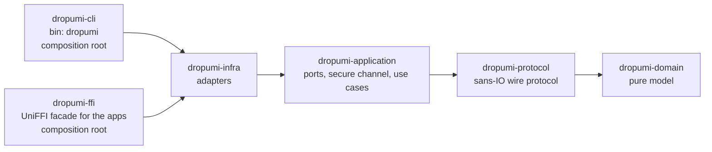
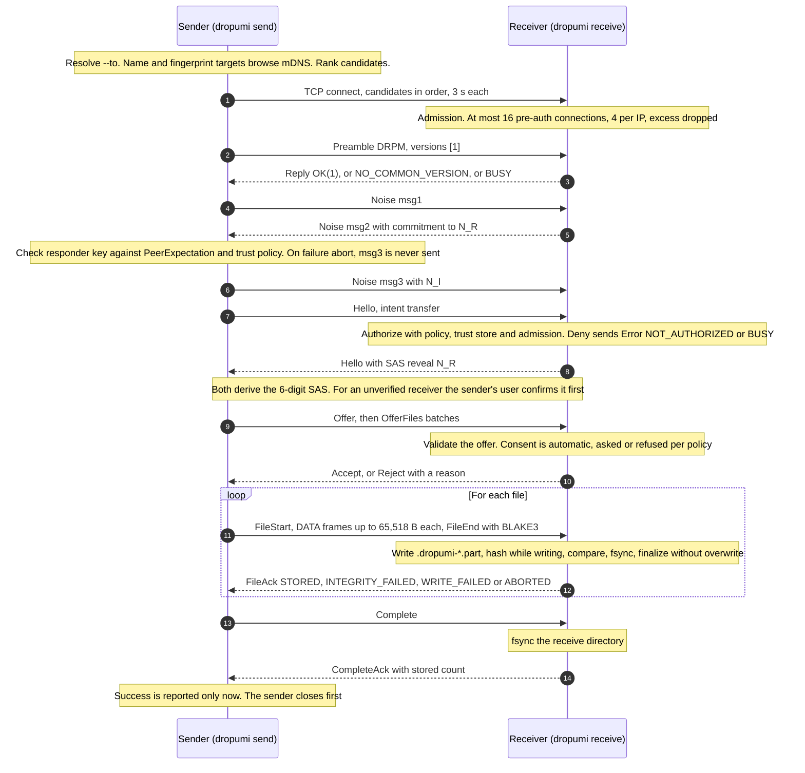

# Architecture

> Pre-alpha. The protocol and implementation are unaudited. This document describes milestone 1 (Rust core,
> protocol v1 draft, `dropumi` CLI) and the start of milestone 2: `dropumi-ffi`, the facade the native apps use
> ([ADR-0009](docs/adr/0009-ffi-bindings-strategy.md)). The apps themselves are in progress.

Dropumi uses ports and adapters (hexagonal architecture) in one Cargo workspace of seven crates: five layers, the
FFI facade and its bindings generator. The decisions behind
this layout are in [ADR-0001](docs/adr/0001-architecture-and-workspace-layout.md); the wire format is in
[`docs/protocol/v1.md`](docs/protocol/v1.md).

## 1. Layers and crates

Arrows mean "depends on". Dependencies point inward only: `domain` <- `protocol` <- `application` <- `infra` <-
`cli` and `ffi`. A crate may also use any crate further inward (for example, `cli` uses all four). `cli` and `ffi` are
both composition roots and do not depend on each other (the CLI uses `ffi` as a dev-dependency only, for interop
tests). `dropumi-ffi-bindgen` is a build tool that holds the UniFFI generator; nothing depends on it.

| Crate | Path | Responsibility | External dependencies (normal) |
|---|---|---|---|
| `dropumi-domain` | `crates/domain` | Identities and fingerprint formats, device names, peers, discovery targets, connection candidates and `PeerExpectation`, transfer policy, trust, `SafeFileName`, `text::strip_unsafe`, transfer request/progress/session state machine, `TransferError`. No I/O, clock, tokio, serde or crypto. | `data-encoding`, `thiserror`, `unicode-normalization` |
| `dropumi-protocol` | `crates/protocol` | Sans-IO protocol v1: version preamble and prologue, records and frames, strict CBOR codec, messages, static identity, Noise XX handshake with committed SAS, `Sealer`/`Opener`, sender and receiver session machines, OS randomness. Bytes in, bytes and events out. | `blake3`, `getrandom`, `minicbor`, `sha2`, `snow`, `thiserror`, `zeroize` |
| `dropumi-application` | `crates/application` | The nine ports, secure-channel establishment and record I/O (`channel::{establish, io}`), use cases, events, timeouts and admission limits. Depends only on ports, never on adapters. | `thiserror`, `tokio`, `tokio-util`, `tracing` |
| `dropumi-infra` | `crates/infra` | Adapters: TCP, receive directory and finalization, file source, stale-file cleanup, identity/device/trust stores, config paths, permission checks, system clock, TXT hints, mDNS (cargo feature `mdns`, on by default). | `dirs`, `serde`, `serde_json`, `tempfile`, `thiserror`, `tokio`, `tracing`, `zeroize`, `rustix` (Unix only), `mdns-sd` (optional) |
| `dropumi-cli` | `crates/cli` | Composition root and the `dropumi` binary: clap arguments, human and NDJSON output, `--control-stdin`, the `Interaction` adapter, exit codes. Holds the two-process e2e suite (`tests/e2e/`). | `clap`, `serde_json`, `tokio`, `tokio-util`, `tracing`, `tracing-subscriber`, `rustix` (Unix only; `termios`) |
| `dropumi-ffi` | `crates/ffi` | Composition root for the apps: `DropumiNode` (identity, trust, discovery, receiving, sending, pairing), the event mailbox, prompts answered by id, and the callback interfaces the apps implement (`EventListener`, `PlatformDiscovery`, `ForeignFile`). Built as `lib`, `staticlib` and `cdylib`. | `uniffi` (`=0.32.2`, no default features), `thiserror`, `tokio`, `tokio-util`, `tracing` |
| `dropumi-ffi-bindgen` | `crates/ffi-bindgen` | Build tool: the `uniffi-bindgen` and `uniffi-bindgen-swift` binaries. Never shipped. | `uniffi` (`cli`, `cargo-metadata`) |

Every direct dependency, its version, license and justification is listed in
[`docs/dependencies.md`](docs/dependencies.md).

### Enforcement

`scripts/ci/check-architecture.sh` (CI job `architecture`) runs `cargo tree -e normal --all-features --target all`
for every crate below and fails if a denied crate appears anywhere in the graph, directly or transitively
("UniFFI" stands for `uniffi`, `uniffi_core`, `uniffi_macros`, `uniffi_bindgen`, `uniffi_pipeline` and
`dropumi-ffi`):

| Package | Denied crates |
|---|---|
| `dropumi-domain` | `tokio`, `tokio-util`, `snow`, `sha2`, `getrandom`, `minicbor`, `blake3`, `mdns-sd`, `tempfile`, `serde`, `serde_json`, `dirs`, `clap`, `tracing`, `tracing-subscriber`, `rustix`, `dropumi-protocol`, `dropumi-application`, `dropumi-infra`, `dropumi-cli` |
| `dropumi-protocol` | `tokio`, `tokio-util`, `mdns-sd`, `tempfile`, `serde`, `serde_json`, `dirs`, `clap`, `tracing`, `tracing-subscriber`, `dropumi-application`, `dropumi-infra`, `dropumi-cli` |
| `dropumi-application` | `mdns-sd`, `tempfile`, `dirs`, `serde`, `serde_json`, `clap`, `tracing-subscriber`, `rustix`, `dropumi-infra`, `dropumi-cli`, UniFFI |
| `dropumi-infra` | `dropumi-cli`, UniFFI |
| `dropumi-cli` (normal dependencies) | UniFFI |
| `dropumi-ffi` | `mdns-sd`, `clap`, `tracing-subscriber`, `dropumi-cli`, `uniffi_bindgen`, `cargo_metadata` |
| whole workspace | `ring` (snow is built with its pure-Rust features only; [ADR-0002](docs/adr/0002-secure-channel-noise-xx.md)) |

The script also fails if any manifest sets `panic = "abort"`: UniFFI turns panics into errors with `catch_unwind`.

Exit status: 0 clean, 1 violation, 2 the dependency graph could not be read. Cycles (for example `infra` depending
on `cli`) are rejected by Cargo itself.

Other rules are enforced by lints: `unsafe_code = "forbid"` in every crate (in `dropumi-ffi` too: the scaffolding
generated by UniFFI's macros is not attributed to the crate; ADR-0009); `unwrap`, `expect`, `panic!`, `todo!`,
`unimplemented!`, `dbg!` and `mem::forget` denied outside tests; the protocol crate also denies `indexing_slicing`,
`arithmetic_side_effects` and `cast_possible_truncation` because it parses untrusted input.

### Domain concepts (spec §9)

| Concept | Code |
|---|---|
| DeviceIdentity | `domain::identity::{DeviceIdentity, PublicKey, Fingerprint, FingerprintPrefix}` |
| Peer, PeerCapabilities | `domain::peer` |
| DiscoveryEvent | `domain::discovery::{DiscoveredPeer, Target}`; `DiscoveryEvent` (found, updated, lost) is defined for a future streaming browse port and is unused in milestone 1, where `Discovery::browse` returns a snapshot |
| ConnectionCandidate, ConnectionState | `domain::connection` (plus `rank_candidates`, `PeerExpectation`, `expectation_for`) |
| TransferRequest, TransferSession, TransferProgress, TransferStatus | `domain::transfer::{request, session, progress, status}` |
| TransferPolicy | `domain::policy` (`authorize`, `consent`) |
| TrustedDevice | `domain::trust` |
| TransferError | `domain::error` (`TransferError::code()` is the one taxonomy behind NDJSON codes and exit codes; received wire error codes map into it, outgoing wire errors use the protocol's `ErrorCode`) |

## 2. Ports and adapters

Ports live in `crates/application/src/ports.rs`. Async methods are native `fn ... -> impl Future + Send`; use cases are
generic over ports and receive them through constructors (no `dyn`, no `async-trait`, no global state).

| Port | Capability | Real adapter | Test double (`crates/application/tests/support/mod.rs`) |
|---|---|---|---|
| `Connector` | Outgoing connections, host-name resolution | `infra::net::TcpConnector` (sets `TCP_NODELAY`) | `FakeConnector` (in-memory `tokio::io::duplex` network `Net`; unknown address = refused) |
| `Listener` | Incoming connections | `infra::net::TcpListenerAdapter` (default port 47321; falls back to an ephemeral port if the default is busy and no `--port` was given) | `FakeListener` |
| `Discovery` | Advertise this device, browse for others | `infra::mdns::MdnsDiscovery` (feature `mdns`); `cli::commands::NoDiscovery` when built without it | `StaticDiscovery` (fixed list) |
| `FileSource` | Inspect, open and re-check files to send | `infra::fs::LocalFileSource` | `MemSource` (with `StallingReader` for stuck sources) |
| `FileSink` | Start received files, sync the directory | `infra::fs::ReceiveDir` | `MemSink` (fault injection: fail after N bytes, block writes; counts begin/commit/discard/dir syncs) |
| `IdentityStore` | Load or create, reset, rename the identity | `infra::store::FileIdentityStore` | `MemIdentity` |
| `TrustStore` | Trusted devices (get, list, upsert, remove, touch) | `infra::store::TrustFile` | `MemTrust` |
| `Interaction` | Offer decisions and SAS confirmation | `cli::interaction::CliInteraction` (control channel, TTY prompt, or "never") | `Scripted` (fixed answers, or never answers) |
| `Clock` | Wall-clock time | `infra::clock::SystemClock` | `ManualClock` |

Helper traits:

| Trait | Role | Real implementation | Test double |
|---|---|---|---|
| `AdHandle` | A running advertisement (`stop`, `instance`) | `infra::mdns::MdnsAd`; `cli::commands::NoAd` without mDNS | `NoAd` |
| `IncomingFile` | A file being received: `write`, `commit` (fsync, then finalize without overwriting), `discard` | `infra::fs::IncomingFsFile` | `MemFile` |

`discard` must be called on every failure path; `Drop` only deletes the temp file as a best-effort fallback.

## 3. Use cases

Use cases live in `crates/application/src/usecases/`.

| Use case (spec §9) | Code | Notes |
|---|---|---|
| DiscoverNearbyDevices | `discovery::discover` | Browses for a fixed time and emits one `PeerFound` per device. Results are hints. |
| ManageDiscoverability | `discovery::advertise`, `AdHandle::stop` | Used by `receive` and `pair --listen`; disabled with `--no-mdns`. Failure emits `DiscoveryUnavailable` and manual addressing keeps working. |
| ConnectToPeer | `connect::{resolve, dial}`, `channel::{initiate, respond}` | `resolve` turns targets into ranked candidates plus a `PeerExpectation`; `dial` tries candidates in order. |
| PairDevice | `pair::{pair_with, pair_listen}` | Committed SAS; trust is stored only if both users confirm. One attempt per listen window. |
| SendFiles | `send::SendFiles` | Success only after `CompleteAck` with every file `STORED`. |
| ReceiveFiles | `receive::ReceiveFiles`, `admission::Admission` | Authorization, consent, safe storage, admission limits. |
| AcceptTransfer, RejectTransfer | `Interaction::decide_offer`, `domain::policy::consent` | An unverified peer never gets automatic acceptance. |
| CancelTransfer | Sender: `CancellationToken`. Receiver: `receive::TransferCanceller` | `cancel` sends `Cancel USER`; stopping the receiver sends `Cancel SHUTDOWN`. |
| QueryTransferProgress | `AppEvent::Progress` events | At most every 250 ms (`send::PROGRESS_INTERVAL`), plus one at the start and one at the end. |
| ManageTrustedDevices | `trust::{list, add_manual, remove}` | Manual trust needs the full 52-character fingerprint. |
| (identity) | `identity::{show, reset, set_name}` | `reset` replaces the key; every peer must pair again. |
| ConfigureBackgroundReceiver | Out of scope for milestone 1 | No service, login item or background mode exists. |

Use cases never print. They emit `AppEvent`s (`crates/application/src/events.rs`) through an `EventSink`; the CLI
renders them as human text or NDJSON ([`docs/cli.md`](docs/cli.md)).

## 4. Secure channel

`crates/application/src/channel/establish.rs` drives the sans-IO protocol over any byte stream:

1. **Preamble** (cleartext): `DRPM`, format 1, the protocol versions this build implements (`[1]`). The responder
   replies OK, NO_COMMON_VERSION or BUSY. Both preamble and reply are bound into the Noise prologue, so tampering
   breaks the handshake.
2. **Noise XX** (`Noise_XX_25519_ChaChaPoly_SHA256`, `snow`). msg2 carries the responder's commitment to its SAS nonce;
   msg3 carries the initiator's nonce.
3. **Responder check before msg3.** The initiator compares the responder's static key with the `PeerExpectation`
   (fingerprint prefix or exact key from the target and `--expect-fingerprint`) and with its trust policy. On mismatch,
   or for an untrusted receiver without `--allow-unverified`, it aborts without sending msg3, so the wrong device never
   learns who called or what was offered.
4. **Hellos** (encrypted): the initiator's Hello carries its intent (`transfer` or `pair`); the responder authorizes
   (policy, trust store, admission) and either answers with its Hello, including the SAS reveal, or sends
   `Error NOT_AUTHORIZED` / `BUSY`. Both sides derive the same 6-digit SAS.

After the handshake, `RecordReader` and `RecordWriter` (`channel/io.rs`) move encrypted records:

- `RecordReader` is cancel-safe: partial-read state survives a cancelled `select!` branch. Every read has a deadline:
  the idle timeout (default 30 s) or a phase-specific limit. The sender's reader task uses a 24 h limit; the sender's
  liveness comes from write stalls and its decision and completion deadlines instead.
- `RecordWriter` fails with `Timeout(Write)` when a write makes no progress for the write-stall timeout (default
  120 s).
- All record buffers are allocated once per session and reused for every record.
- `Connected` events carry `handshake_us`, measured from the start of the preamble to the end of the Hello exchange.

## 5. Send and receive sequence

| Step | Code |
|---|---|
| Target parsing, resolution, ranking, expectation | `domain::discovery`, `domain::connection`, `application::usecases::connect` |
| Preamble, handshake, Hellos | `application::channel::establish` over `protocol::{version, handshake, sas}` |
| Records and frames | `application::channel::io` over `protocol::{record, frame}` |
| Offer validation, per-file state, hashing | `protocol::session::{SenderMachine, ReceiverMachine}` |
| Authorization and consent | `domain::policy::{authorize, consent}`, `Interaction` port |
| File naming and storage | `domain::filename::SafeFileName`, `infra::fs::{receive_dir, finalize}` |

**Pairing** (`pair --listen` / `pair --to`) uses the same preamble, handshake and Hellos with intent `pair`. Both
users compare the SAS, each side sends `PairResult`, and trust is stored on both sides only if both confirmed.
`receive` refuses `pair` intents and `pair --listen` refuses `transfer` intents (`Error NOT_AUTHORIZED`).

**Termination.** Before closing after a final message, a peer half-closes its write direction and drains input for at
most 2 s (`Timeouts::drain`), so the other side can read the final `Cancel`, `Error` or `CompleteAck`.

## 6. Concurrency model

| Element | Behaviour |
|---|---|
| Runtime | One tokio `current_thread` runtime per process (`enable_all`, `max_blocking_threads(8)`). All async tasks run on the main thread. |
| Blocking work | `tokio::fs` file I/O, temp-file creation, finalization, directory fsync and temp-file removal run on the blocking pool (at most 8 threads). |
| Other threads | The `--control-stdin` reader thread; a terminal reader thread, started at the first terminal prompt (on Unix, input still queued in the terminal is flushed before every prompt, so it cannot answer a question the user has not seen); the `mdns-sd` daemon thread, started lazily on the first advertise or browse (feature `mdns` only). |
| Event output | Use cases emit `AppEvent`s into a bounded channel (256). When the printer falls behind, `emit` waits (backpressure). |
| Control input | The stdin thread forwards lines over an unbounded channel (local input only). A router task delivers each decision through a one-shot channel to the prompt that is waiting (offers matched by `transfer_id`); a decision with no matching prompt is dropped with a warning, never queued. `cancel` and `quit` run immediately. |
| Sender | The use-case task writes records. A spawned reader task reads records and forwards control messages over a bounded channel (8); it is aborted when the transfer ends (`AbortOnDrop`). Source reads race cancellation and inbound messages in `select!`, so a stuck source never blocks a receiver's `Cancel`. |
| Receiver | `ReceiveFiles::run` accepts connections and spawns one task per connection into a `JoinSet`. Each session reads a frame, writes it to the sink, then reads the next: no queue between network and disk, so a slow disk slows the sender through TCP. |
| Admission | At most 16 unauthenticated connections in total and 4 per remote IP (excess dropped immediately, no queue); at most 4 authenticated sessions (excess get `BUSY` at the preamble); at most 1 active session per peer fingerprint (excess get `BUSY` after the Hello). |
| Cancellation | A root `CancellationToken` (Ctrl-C, `quit`) with child tokens per command; the receiver waits at most 4 s for open sessions to close (plus up to 2 s to withdraw its mDNS advertisement and stop the mDNS daemon), and a second Ctrl-C exits the process at once with code 130. The receiver's `TransferCanceller` cancels every running transfer, or one by transfer id (`Cancel USER`), without stopping the receiver; an offer that reuses the id of a running transfer is rejected `BUSY`. Stopping the receiver cancels sessions with `Cancel SHUTDOWN`, waits up to 4 s (twice the drain timeout), then aborts what is left. `ReceiverControl::stop_accepting` instead closes the listener at once and lets running sessions finish. |
| Accept errors | Retried after a pause (10 ms, doubling, at most 1 s); after 8 consecutive failures the receiver drains and returns an error instead of spinning. |

Default timeouts (`crates/application/src/config.rs`):

| Timeout | Default | Timeout | Default |
|---|---|---|---|
| TCP connect, per candidate | 3 s | Receiver idle during a transfer | 30 s |
| Preamble, handshake and Hellos | 10 s | Write stall | 120 s |
| Whole offer from a trusted peer | 30 s | Sender waiting for Accept/Reject | 150 s |
| Whole offer from an unverified peer | 150 s | Sender waiting for `CompleteAck` (restarted by each new `FileAck`) | 60 s |
| Receiving user's decision | 120 s | Drain after a final message | 2 s |
| SAS confirmation and pairing result | 120 s | | |

### The app facade (`dropumi-ffi`)

| Element | Behaviour |
|---|---|
| Runtime | One tokio `current_thread` runtime on its own thread (`dropumi-rt`), `max_blocking_threads(8)`. Exported calls are synchronous; long work is spawned on the runtime. |
| Events | Use cases emit into a bounded channel per operation (256); a pump forwards each event to the mailbox without waiting. The `dropumi-events` thread delivers batches (at most 256; critical events at once, others at most every 100 ms) to the app's `EventListener`. The mailbox is bounded (critical: 4,096, then `ResyncRequired`; soft: 1,024, oldest dropped) and never makes the core wait. |
| App code | Never called on the runtime thread or under a Rust lock: each call into `PlatformDiscovery` runs on a short-lived thread (`dropumi-app`), and each document is read on its own thread (`dropumi-reader`) into a channel of 4 chunks of 256 KiB. |
| Prompts | Registered before `PromptOpened` is published; answered by prompt id; withdrawn when the core stops waiting. |
| Shutdown | `shutdown()` cancels everything, waits up to 5 s for the receiver, stops the runtime and drains the mailbox. Dropping the last handle cancels without waiting. |

### The Apple app (`apps/apple`, [ADR-0012](docs/adr/0012-apple-apps.md))

| Layer | What it does |
|---|---|
| `DropumiCore` (Swift package) | `LiveCoreClient` wraps `DropumiNode`. An `EventBridge` turns the facade's listener calls into an `AsyncStream` without blocking. `BonjourDiscovery` implements `PlatformDiscovery` with DNS-SD. `AppPaths` chooses the app-private folders. |
| `DropumiAppState` | `@MainActor @Observable AppModel` holds every piece of UI state and reduces the core's events. Core calls run on detached tasks at the core threads' default priority. Receiver changes and discovery starts and stops are serialized. |
| `DropumiDesign` | design.md tokens, fonts and shared components. No core. |
| `DropumiShare` | The App Group inbox shared with the Share Extension. No core. |
| App targets | SwiftUI screens that render `AppModel`, the prompt presenter, platform hooks: background completion on iOS; the menu bar, notifications and login item on the Mac. |

## 7. Memory

**Design estimate, not measured.** Per authenticated session, `channel/io.rs` allocates its record buffers once,
after the handshake:

| Buffer | Size |
|---|---|
| `RecordReader`: ciphertext (`MAX_RECORD`) + plaintext (`NOISE_MAX_MSG`) | 65,537 + 65,535 B |
| `RecordWriter`: plaintext (`MAX_PLAINTEXT`) + ciphertext (`MAX_RECORD`) + control scratch (initial capacity) | 65,519 + 65,537 + 1,024 B |
| Subtotal, both directions | 263,152 B (about 257 KiB) |
| Sender only: file read buffer (`MAX_FRAME_BODY`, `send.rs`) | 65,518 B |
| `tokio::fs::File` copies each read or write through its own buffer, sized to the request (at most one frame here) | up to 65,518 B per open file |

That gives roughly 321 KiB per receiving session and 385 KiB per sending session, independent of file size; a
receiver with 4 sessions holds about 1.25 MiB of record buffers. Not included: snow's internal state, the tokio
runtime, the allocator, the `mdns-sd` daemon, channels, and the offer's file list (its encoded size is capped at
4 MiB; its in-memory size is not measured).

**Measured** with `scripts/bench/loopback.sh` (macOS 27 arm64, Apple M4 Pro, Rust 1.99.0, loopback, median of 3
runs; whole-process peak RSS from `/usr/bin/time -l`):

| Process | 256 MiB file | 1,000 × 100 KiB files |
|---|---|---|
| Sender peak RSS | 4,416 KiB | 6,112 KiB |
| Receiver peak RSS | 4,400 KiB | 6,720 KiB |
| Idle receiver RSS (after 10 s) | 3,744 KiB | |

The 256 MiB transfer peaked at 4,416 KiB (sender) and 4,400 KiB (receiver), so file content is streamed, not buffered whole. Why the
many-files workload peaks 1,696 KiB (sender) and 2,320 KiB (receiver) higher was not investigated. The Linux-only e2e test
`transfer::bounded_memory_independent_of_size` checks that the receiver's peak grows by less than 16 MiB between a
16 MiB and a 256 MiB transfer; it passed in a Debian 12 aarch64 container (local run) and is pending CI on `ubuntu-latest`.
No memory figures were measured on Windows, Linux or mobile.

## 8. Errors

- `thiserror` only; public error enums are `#[non_exhaustive]`.
- Port errors (`TransportError`, `StorageError`, `SourceError`, `StoreError`, `DiscoveryError`) map into
  `domain::error::TransferError`. `UseCaseError` covers failures before any session exists (usage, resolution,
  discovery, configuration).
- `TransferError::code()` gives one stable code used for NDJSON `failed` events and exit codes
  (`crates/cli/src/exit.rs`).
- Nothing local reaches the peer: the wire `Error.detail` is a fixed phrase per code (`ErrorCode::wire_detail`), and
  storage or OS error text stays local.

## 9. Where future adapters go

No new crate is created until a second implementation needs it ([ADR-0001](docs/adr/0001-architecture-and-workspace-layout.md)).
Planned extension points:

| Future capability | Plugs in as | Notes |
|---|---|---|
| BLE discovery | A new `Discovery` adapter | Discovery stays separate from transport; results stay hints. |
| Native Bonjour/NSD discovery | `dropumi-ffi`'s `PlatformDiscovery`, implemented by the apps | Rust names instances and builds and parses TXT. |
| Wi-Fi Direct, Wi-Fi Aware, hotspot transports | New `Connector`/`Listener` adapters | The secure channel runs over any `AsyncRead + AsyncWrite` stream. |
| Keychain, Android Keystore, Windows credential storage | New `IdentityStore` adapters | Today the key is a 0600 file; on the app platforms it stays in app-private storage excluded from backups until then ([ADR-0014](docs/adr/0014-interim-key-storage-on-app-platforms.md)). |
| Notifications, share sheets, permission prompts | New `Interaction` adapters and future platform ports | The CLI has no OS permission prompts. |
| Desktop and mobile apps | `apps/apple` (iPhone, iPad, Mac: [ADR-0012](docs/adr/0012-apple-apps.md)), `apps/android` (milestone 2, in progress) | Platform code stays in the apps, behind the facade's callback interfaces. Windows and Linux UIs are undecided. |
| Language bindings | `dropumi-ffi` ([ADR-0009](docs/adr/0009-ffi-bindings-strategy.md), Accepted) | Exposes use cases, not ports; Swift and Kotlin are generated. |

The spec's separate `discovery`, `transport`, `security`, `platform` and `testing` crates are deferred. Until then,
discovery lives in `domain::discovery` and `infra::mdns`, transport in `application::channel` and `infra::net`,
security in `protocol::{identity, handshake, sas, record}`, and test utilities in each crate's tests.

## 10. Related documents

- [`docs/cli.md`](docs/cli.md): commands, NDJSON events, exit codes.
- [`docs/protocol/v1.md`](docs/protocol/v1.md), [`docs/protocol/threat-model.md`](docs/protocol/threat-model.md),
  [`docs/protocol/discovery.md`](docs/protocol/discovery.md).
- [`docs/testing.md`](docs/testing.md): test layers, harness and what has been verified.
- [`docs/development.md`](docs/development.md): toolchains and the commands CI runs.
- [`docs/adr/`](docs/adr/): decisions.
