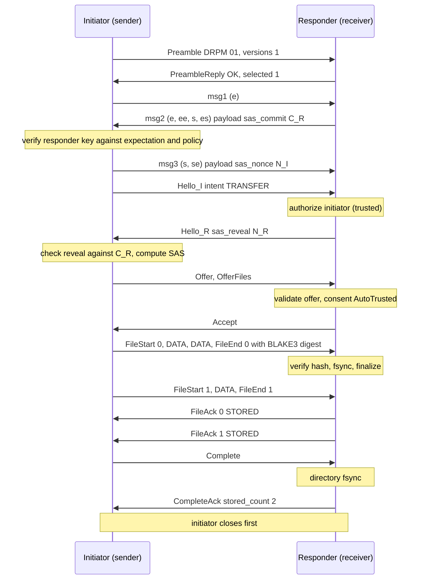
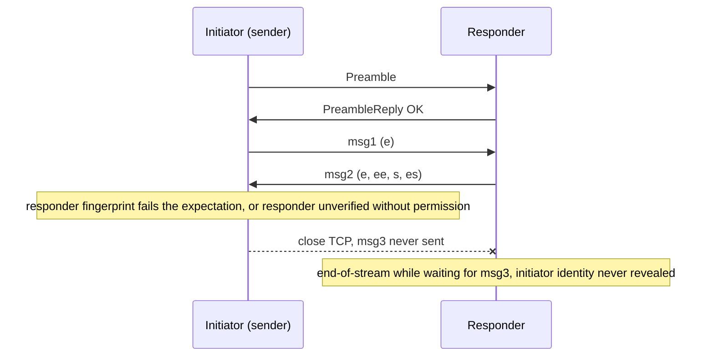
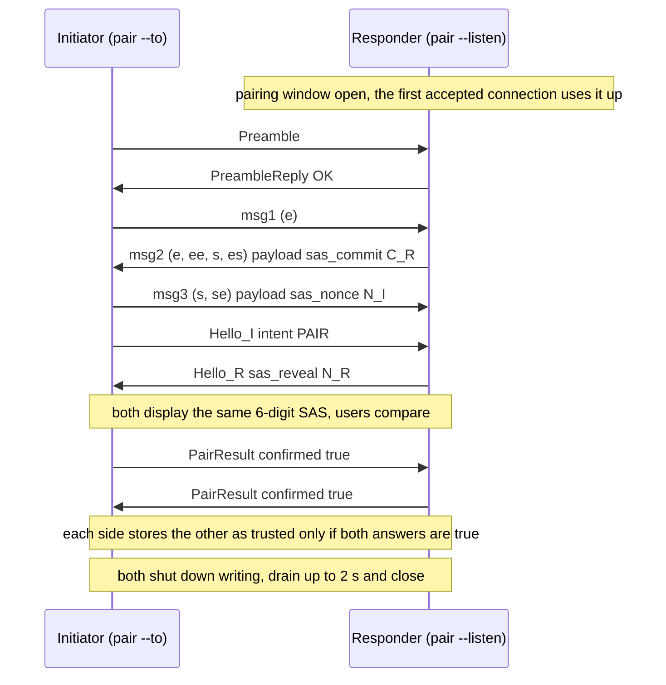
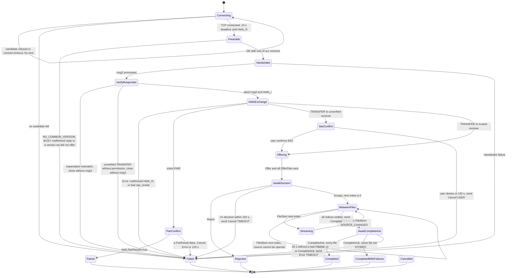
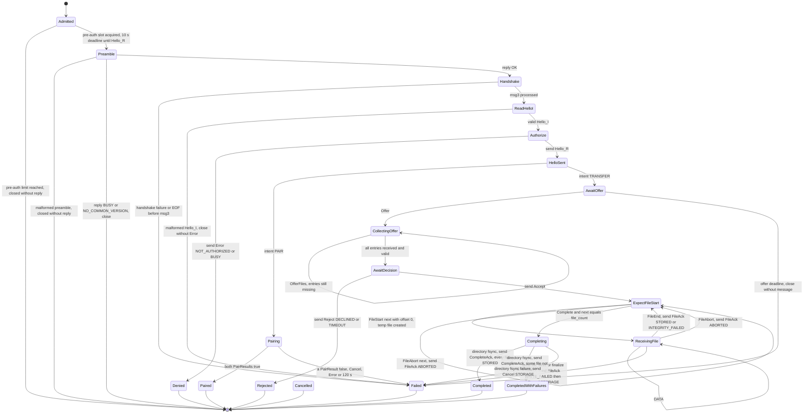

# Dropumi protocol, version 1

| | |
|---|---|
| Status | **Draft. Unaudited.** No third-party review has taken place. |
| Protocol version | 1 |
| Document date | 2026-10-13 (reconciled with the milestone 1 reference implementation on the same date) |
| Applies to | Dropumi pre-alpha (`dropumi` CLI and the crates in this repository) |
| Related documents | [`threat-model.md`](threat-model.md), [`discovery.md`](discovery.md), [ADR-0005](../adr/0005-wire-protocol-v1.md) |

> **Warning.** Dropumi is pre-alpha software. This protocol and its implementation have not been audited, and the
> underlying Noise library (`snow`) has not received a formal audit either. Do not rely on Dropumi to protect
> sensitive data yet.

## Contents

1. [Status of this document](#1-status-of-this-document)
2. [Conventions and terminology](#2-conventions-and-terminology)
3. [Protocol overview](#3-protocol-overview)
4. [Cryptographic suite and domain-separation labels](#4-cryptographic-suite-and-domain-separation-labels)
5. [Device identity and fingerprints](#5-device-identity-and-fingerprints)
6. [Connection establishment](#6-connection-establishment)
7. [Records and frames](#7-records-and-frames)
8. [Message encoding (strict CBOR)](#8-message-encoding-strict-cbor)
9. [Message catalogue](#9-message-catalogue)
10. [Session start](#10-session-start)
11. [Committed short authentication string (SAS)](#11-committed-short-authentication-string-sas)
12. [Authorization, consent and pairing](#12-authorization-consent-and-pairing)
13. [Transfer flow](#13-transfer-flow)
14. [State machines](#14-state-machines)
15. [Integrity and completion semantics](#15-integrity-and-completion-semantics)
16. [Cancellation, errors and termination](#16-cancellation-errors-and-termination)
17. [Limits and timeouts](#17-limits-and-timeouts)
18. [Receiver filesystem requirements](#18-receiver-filesystem-requirements)
19. [Extensibility and versioning](#19-extensibility-and-versioning)
20. [Security considerations](#20-security-considerations)
21. [Changelog](#21-changelog)
- [Appendix A. CDDL schema](#appendix-a-cddl-schema)
- [Appendix B. Test vectors and byte examples (informative)](#appendix-b-test-vectors-and-byte-examples-informative)
- [Appendix C. Reference implementation map (informative)](#appendix-c-reference-implementation-map-informative)
- [Appendix D. References](#appendix-d-references)

---

## 1. Status of this document

- This is the **normative draft** of Dropumi protocol version 1: the wire protocol two Dropumi devices use to
  authenticate each other and transfer files over a local network.
- The protocol is a **draft**. While this document carries the status "Draft", the version-1 wire format may still
  change incompatibly without a new version number (see [§19.4](#194-versioning-policy)). Implementations built from
  different draft revisions are not guaranteed to interoperate.
- Sections and paragraphs marked *(informative)* explain or give examples. Everything else is normative.
- Paragraphs marked *Reference:* describe what the reference implementation in this repository does. They were checked
  against the code; where the reference does less than a SHOULD or MAY allows, the paragraph says so.
- Discovery (mDNS/DNS-SD) is specified separately in [`discovery.md`](discovery.md). Discovery data is never
  identity; this document only relies on it through the peer expectation rule ([§12.6](#126-peer-expectation-rule)).
- The security analysis lives in [`threat-model.md`](threat-model.md).

## 2. Conventions and terminology

### 2.1 Requirements notation

The key words "MUST", "MUST NOT", "REQUIRED", "SHALL", "SHALL NOT", "SHOULD", "SHOULD NOT", "RECOMMENDED",
"NOT RECOMMENDED", "MAY", and "OPTIONAL" in this document are to be interpreted as described in BCP 14
([RFC 2119], [RFC 8174]) when, and only when, they appear in all capitals, as shown here.

### 2.2 Notation

| Notation | Meaning |
|---|---|
| `‖` | Byte-string concatenation |
| `u8`, `u16be`, `u64be` | Unsigned integer of 1 byte; 2 bytes big-endian; 8 bytes big-endian |
| `"text"` | The ASCII bytes of the string, without a terminating NUL and without a length prefix |
| `B`, `KiB`, `MiB` | Bytes; 1,024 B; 1,048,576 B |
| `X[a..b]` | Bytes `a` (inclusive) to `b` (exclusive) of `X` |
| `SHA-256(x)` | SHA-256 [FIPS 180-4] of `x`, 32 bytes |
| `BLAKE3-256(x)` | BLAKE3 [BLAKE3] in its default hashing mode with a 32-byte output |
| `bstr32`, `bstr16` | CBOR byte string of exactly 32 or 16 bytes |
| `tstr` | CBOR text string (UTF-8) |
| `uint`, `int` | CBOR unsigned integer; CBOR unsigned or negative integer |

### 2.3 Terms

| Term | Meaning |
|---|---|
| Initiator (I) | The peer that opens the TCP connection. In a TRANSFER session the initiator is always the **sender**. |
| Responder (R) | The peer that accepts the TCP connection. In a TRANSFER session the responder is always the **receiver**. |
| Session | One TCP connection, from the preamble to connection close. v1 carries at most one transfer per session. |
| Static key | The long-term X25519 key pair of an installation ([§5](#5-device-identity-and-fingerprints)). |
| Fingerprint | `SHA-256("dropumi/v1/device-fingerprint" ‖ static public key)` ([§5.2](#52-fingerprint)). |
| Trusted peer | A peer whose fingerprint is in the local trust store. |
| Unverified peer | Any authenticated peer whose fingerprint is not in the local trust store. "Unverified" never means "unauthenticated": every v1 session is cryptographically authenticated to *some* static key. |
| Record | One length-prefixed Noise message on the wire ([§7.1](#71-records)). |
| Frame | The plaintext inside one transport record: a frame type byte plus a body ([§7.3](#73-frames)). |
| Message | One CBOR-encoded CONTROL frame body ([§8](#8-message-encoding-strict-cbor)). |
| Ignorable message | A message whose type is in 128–255 ([§8.4](#84-unknown-keys-and-unknown-message-types)). |
| Fatal | The session ends and the peer reports a failure. Once the encrypted channel exists, the peer applies the termination rule ([§16.4](#164-termination-rule)); before that, it simply closes the connection. |

## 3. Protocol overview

*(informative)*

```
+------------------------------------------------------------+
| Messages: Hello, Offer, OfferFiles, FileStart, FileAck ... |  strict CBOR (§8, §9)
+------------------------------------------------------------+
| Frames: 0x01 CONTROL (one message) | 0x02 DATA (file bytes)|  (§7.3)
+------------------------------------------------------------+
| Records: u16be length ‖ Noise transport message (AEAD)     |  (§7.1)
+------------------------------------------------------------+
| Noise_XX_25519_ChaChaPoly_SHA256 handshake (3 messages)    |  (§6.6)
+------------------------------------------------------------+
| Cleartext preamble "DRPM" 0x01 + versions, and its reply   |  bound into the Noise prologue (§6.2-§6.5)
+------------------------------------------------------------+
| TCP (any reliable, ordered, full-duplex byte stream)       |  (§6.1)
+------------------------------------------------------------+
```

A v1 session proceeds as follows:

1. The initiator opens a TCP connection and sends a cleartext **preamble** listing the protocol versions it implements.
   The responder replies with the selected version, or with NO_COMMON_VERSION or BUSY.
2. Both peers run a **Noise XX** handshake. The exact preamble bytes are mixed into the Noise prologue, so tampering
   with version negotiation breaks the handshake. Each peer learns the other's static public key, and therefore its
   fingerprint.
3. Before sending the third handshake message, the initiator checks the responder's key against what it expected
   ([§12.6](#126-peer-expectation-rule)) and against its policy ([§12.5](#125-initiator-sender-policy)). If the check
   fails, it closes the connection without ever revealing its own static key.
4. The handshake also carries a **commitment** for a 6-digit short authentication string (SAS), so a man-in-the-middle
   gets a single guess per attempt ([§11](#11-committed-short-authentication-string-sas)).
5. The peers exchange encrypted **Hello** messages. The responder authorizes the initiator before replying
   ([§12.2](#122-responder-authorization)).
6. The session then either **pairs** the two devices (intent PAIR) or carries one **transfer** (intent TRANSFER):
   Offer → Accept/Reject → per-file FileStart, DATA frames, FileEnd → FileAck → Complete → CompleteAck.

## 4. Cryptographic suite and domain-separation labels

### 4.1 Suite

Protocol version 1 uses exactly one cipher suite and one handshake pattern:

```
Noise_XX_25519_ChaChaPoly_SHA256
```

- Pattern **XX**: mutual authentication with static keys that do not need to be known in advance.
- DH function **25519** (X25519, [RFC 7748]).
- Cipher **ChaChaPoly** (ChaCha20-Poly1305, 16-byte tag).
- Hash **SHA256** (used by Noise and by every Dropumi-level hash except the per-file content hash).
- Per-file content hash: **BLAKE3-256**, algorithm identifier `1` ([§15.1](#151-content-hash)).

Any change to the suite, the pattern or the handshake payload semantics requires a new protocol version number
([§19.4](#194-versioning-policy)). Implementations MUST NOT negotiate a different Noise protocol name under version 1.

### 4.2 Domain-separation labels

Every Dropumi-level hash input starts with a fixed ASCII label. Labels are used as raw bytes: no NUL terminator, no
length prefix. All other inputs to these hashes have fixed lengths, so the concatenations are unambiguous.

| Label | Bytes | Used for |
|---|---|---|
| `"dropumi/v1/device-fingerprint"` | 29 | Device fingerprint ([§5.2](#52-fingerprint)) |
| `"dropumi/v1/sas-commit"` | 21 | SAS commitment `C_R` ([§11.2](#112-construction)) |
| `"dropumi/v1/sas"` | 14 | SAS value ([§11.2](#112-construction)) |
| `"DROPUMI-PROLOGUE"` | 16 | Prefix of the Noise prologue ([§6.5](#65-prologue-binding)) |

### 4.3 Randomness

All random values (static secret keys, Noise ephemeral keys, SAS nonces `N_I` and `N_R`, transfer identifiers) MUST
come from a cryptographically secure random number generator provided by the operating system. SAS nonces and
transfer identifiers MUST be freshly generated for every session and MUST NOT be reused.

*Reference:* static keys, SAS nonces and transfer identifiers come from `getrandom`; Noise ephemeral keys are generated
inside `snow`.

## 5. Device identity and fingerprints

### 5.1 Static key

- Each installation has exactly one long-term X25519 key pair, the **static key**. It is both the Noise static key
  and the device identity. v1 has no other identity key.
- The 32-byte secret MUST be generated from the operating system CSPRNG. The public key is `X25519(secret, 9)`
  ([RFC 7748]); clamping is applied by the X25519 function.
- Resetting the identity (`dropumi identity reset`) generates a new key pair. Peers then see a new, unverified device.
  v1 has no in-band key rotation and no revocation.
- How the secret is stored is an implementation matter. *Reference:* a file named `identity.key` in the configuration
  directory, containing the 8-byte magic `DRPMKEY1` followed by the 32-byte secret (mode 0600 on Unix, in a 0700
  directory). The in-memory copy held by Dropumi is zeroized when dropped. See
  [ADR-0003](../adr/0003-device-identity-and-key-storage.md) and [`SECURITY.md`](../../SECURITY.md).

### 5.2 Fingerprint

```
fingerprint = SHA-256("dropumi/v1/device-fingerprint" ‖ static_public_key)      ; 32 bytes
```

`static_public_key` is the raw 32-byte X25519 public key exactly as transmitted in the Noise handshake.

### 5.3 Text forms

All text forms use the base32 alphabet of [RFC 4648] §6 (`A`–`Z`, `2`–`7`), upper case, **without padding**.

| Form | Content | Length | Example (vector from Appendix B) |
|---|---|---|---|
| Full | base32 of all 32 bytes | 52 characters | `QLARLUQOXKSVO4B6FERSNH3MRDB427ZIYR4JJE2NM4YDJ3KZ7H4Q` |
| Display | base32 of the first 15 bytes (120 bits), in six groups of four separated by `-` | 24 characters (29 with separators) | `QLAR-LUQO-XKSV-O4B6-FERS-NH3M` |
| mDNS hint | The first 8 characters of the full form (40 bits) | 8 characters | `QLARLUQO` |

Because 15 bytes encode to exactly 24 base32 characters, the display form (without separators) is always a prefix of
the full form, and the mDNS hint is a prefix of both.

- The **full** form is used for `trust add`, `trust remove`, JSON output and any place where a fingerprint is stored
  or compared exactly.
- The **display** form is what users compare by eye. Its 120-bit prefix makes a second-preimage attack cost on the
  order of 2^120 key generations.
- The **mDNS hint** is a selector only. 40 bits can be ground with feasible effort, so the hint MUST NOT be used as
  evidence of identity ([`discovery.md`](discovery.md)).

### 5.4 Parsing

- A parser for the full form MUST remove every `-` and space, accept upper or lower case, and require exactly 52
  remaining characters from the alphabet. It MUST reject a final character that encodes non-zero padding bits, so
  that each fingerprint has exactly one full text form.
- A **fingerprint prefix** is a string of 8 to 52 base32 characters after removing `-` and spaces, compared
  case-insensitively against the start of the full form. Any other character makes the prefix invalid.
- A prefix of at least 24 characters (120 bits) is a **pin**. Wherever this specification or the CLI requires a pin
  (for example `--expect-fingerprint`), shorter prefixes MUST be refused.

### 5.5 Trust store

*(informative)* A trust store maps full fingerprints to entries `{fingerprint, public_key (optional), alias
(optional), method, added_at, last_seen (optional)}`, where `method` is `sas` (paired with
[§12.7](#127-pair-sessions)) or `manual` (`trust add` after an out-of-band comparison of full fingerprints; a manual
entry has no public key). There is **no trust on first use (TOFU)**: a key seen for the first time is never trusted
automatically. Discovery names, mDNS records and IP addresses are never identity.

## 6. Connection establishment

### 6.1 Transport

- v1 runs over TCP. Any reliable, ordered, full-duplex byte stream can carry it.
- *Reference:* the receiver listens on `0.0.0.0:47321` by default (`--bind`, `--port`). If the default port is busy
  and the user did not choose a port, it falls back to an ephemeral port and advertises the actual port over mDNS.
  Port 47321 is a default, not an IANA assignment. Both sides disable Nagle's algorithm (`TCP_NODELAY`), which
  implementations SHOULD also do.
- The connection layout is:

```
I→R  Preamble        "DRPM" 0x01 n:u8 n×u16be                       cleartext, ≤ 22 B   (§6.2)
R→I  PreambleReply   "DRPM" 0x01 status:u8 ...                      cleartext, ≤ 23 B   (§6.3)
I→R  u16be(32)  ‖ msg1   -> e                 payload: empty                            (§6.6)
R→I  u16be(len) ‖ msg2   <- e, ee, s, es      payload: CBOR {1: sas_commit}             (§6.6)
     [initiator verifies the responder (§6.7); on failure it closes WITHOUT sending msg3]
I→R  u16be(len) ‖ msg3   -> s, se             payload: CBOR {1: sas_nonce}              (§6.6)
both u16be(len) ‖ transport message, repeated (17 ≤ len ≤ 65,535)                       (§7)
```

### 6.2 Preamble

The initiator sends:

| Field | Size | Value |
|---|---|---|
| magic | 4 B | `"DRPM"` = `44 52 50 4D` |
| format | 1 B | `0x01` |
| n | 1 B | Number of versions, 1..=8 |
| versions | n × 2 B | Protocol versions the initiator implements, as `u16be`, **strictly descending** |

- The preamble is 8 to 22 bytes long. *Reference:* the initiator sends `[1]`, so its preamble is 8 bytes.
- The responder reads the 6-byte header first and validates magic, format and `n` before reading the version list.
- If the magic or format byte is wrong, `n` is 0 or greater than 8, or the versions are not strictly descending, the
  responder MUST close the connection **without replying**.
- The initiator MUST NOT send msg1 before it has received an OK reply.

### 6.3 Preamble reply

The responder sends `"DRPM"`, `0x01`, then a status byte:

| Status | Name | Following bytes | Total size | Then |
|---|---|---|---|---|
| `0x00` | OK | `selected: u16be` | 8 B | The handshake starts |
| `0x01` | NO_COMMON_VERSION | `n: u8` (at most 8), `n × u16be` (the responder's versions, strictly descending) | 7–23 B | The responder closes |
| `0x02` | BUSY | none | 6 B | The responder closes |

- The responder sends BUSY when all its authenticated-session slots are in use ([§17.2](#172-admission-control)).
- If the reply has a wrong magic or format, an unknown status, or a NO_COMMON_VERSION count above 8, the initiator MUST
  close the connection and report a failure.
- NO_COMMON_VERSION and BUSY replies are unauthenticated. An initiator MAY show the listed versions to the user, but
  MUST NOT act on them other than by reporting the failure.

### 6.4 Version selection

- The responder MUST select the **highest** version that appears in both its own list and the initiator's list.
- The initiator MUST check that `selected` is in its own list, and close the connection otherwise.
- Implementations MUST NOT automatically retry with a lower version after any failure. An attacker who can make a
  connection fail can then only cause denial of service, never a downgrade.
- Version `1` is the protocol in this document.

### 6.5 Prologue binding

Both peers initialize Noise with this prologue:

```
prologue = "DROPUMI-PROLOGUE" ‖ u8(len(P)) ‖ P ‖ u8(len(R)) ‖ R
```

- `P` is the exact sequence of preamble bytes the initiator sent (initiator) or received (responder).
- `R` is the exact sequence of reply bytes the responder sent (responder) or received (initiator). Only an OK reply
  leads to a handshake, so `R` is always the 8-byte OK reply in practice.
- If an attacker changes any byte of `P` or `R` in transit, the two prologues differ, the handshake hashes diverge, and
  msg2 fails to decrypt at the initiator. The session then fails (local error `handshake_failed`).

### 6.6 Noise XX handshake and payloads

The handshake is `Noise_XX_25519_ChaChaPoly_SHA256` [Noise] with the prologue from [§6.5](#65-prologue-binding).
Each handshake message travels in one record (`u16be len ‖ message`).

| Message | Direction | Tokens | Payload | Size with v1 payloads |
|---|---|---|---|---|
| msg1 | I→R | `-> e` | MUST be empty | exactly 32 B |
| msg2 | R→I | `<- e, ee, s, es` | CBOR map `{1: sas_commit (bstr32)}` | 132 B |
| msg3 | I→R | `-> s, se` | CBOR map `{1: sas_nonce (bstr32)}` | 100 B |

- `sas_commit` is `C_R = SHA-256("dropumi/v1/sas-commit" ‖ N_R)`, where `N_R` is 32 fresh random bytes chosen by the
  responder ([§11](#11-committed-short-authentication-string-sas)).
- `sas_nonce` is `N_I`, 32 fresh random bytes chosen by the initiator.
- Handshake length rules (checked **before** any allocation or read of the body):
  - A record length in the handshake phase MUST be 1..=512 B.
  - msg1 MUST be exactly 32 B. A responder MUST reject any other msg1 length; a msg1 with a payload is rejected.
  - A decrypted handshake payload MUST be at most 256 B.
- The msg2 and msg3 payloads follow the strict CBOR rules of [§8](#8-message-encoding-strict-cbor), except that they
  are bare maps (nesting depth 1) rather than `[type, body]` messages. Unknown keys are skipped. Key 1 is REQUIRED.
- Any handshake failure (decryption failure, length violation, malformed payload) is fatal. No encrypted channel exists
  yet, so the failing peer closes the connection without sending an error.

### 6.7 Responder verification before msg3

After msg2 has been processed, the initiator knows the responder's static public key `rs` and therefore its
fingerprint. Before it sends msg3, the initiator MUST:

1. Check `rs` against its **peer expectation** ([§12.6](#126-peer-expectation-rule)). On mismatch: fail with
   `peer_identity_mismatch`.
2. Apply its sending policy ([§12.5](#125-initiator-sender-policy)): if the intent is TRANSFER, the responder is
   unverified and the user did not allow unverified receivers, fail with `unverified_peer`.

On either failure the initiator MUST close the connection **without sending msg3**. Because the initiator's static key
is only transmitted (encrypted) in msg3, an unexpected responder never learns who tried to connect. The responder
observes end-of-stream while waiting for msg3 (*Reference:* it reports `handshake_failed`).

### 6.8 Transition to transport mode

- After msg3, both peers record the Noise handshake hash `h` (32 bytes). Implementations MUST capture `h` before
  converting the handshake state into transport mode, because it is needed for the SAS
  ([§11](#11-committed-short-authentication-string-sas)).
- Both peers then switch to transport mode with one cipher state per direction (Noise `Split()`), each with an
  implicit nonce counter that starts at 0 ([§7.2](#72-nonces-and-record-failure)).
- The first transport message in each direction is a CONTROL frame carrying Hello, except that the responder MAY send
  Error instead of Hello ([§10](#10-session-start)).

## 7. Records and frames

### 7.1 Records

```
record = u16be(len) ‖ noise_message          ; noise_message is exactly len bytes
```

| Phase | Allowed `len` |
|---|---|
| Handshake | msg1: exactly 32. msg2, msg3: 1..=512 |
| Transport | 17..=65,535 (16-byte AEAD tag plus at least 1 plaintext byte) |

- A peer MUST validate `len` before allocating a buffer for, or reading, the record body. A length outside the allowed
  range is fatal. *Reference:* a handshake length above 512 is reported locally as `limit_exceeded`.
- One record carries exactly one Noise message, and one transport record carries exactly one frame. v1 has no
  fragmentation across records.

### 7.2 Nonces and record failure

- Transport nonces are implicit per-direction counters starting at 0. They are never transmitted. A receiver
  increments its counter only after a successful decryption.
- Any decryption failure of a transport record is **fatal**. After a failure, the receiving direction MUST NOT
  decrypt any further record (the opener is "poisoned"). The failing peer MAY send `Error PROTOCOL_VIOLATION` on its
  still-intact sending direction and then MUST apply the termination rule ([§16.4](#164-termination-rule)).
  *Reference:* it sends that Error and reports `integrity` locally.
- TCP delivers bytes in order, so any dropped, reordered, replayed, injected or modified record fails decryption.
- v1 has **no rekey**. A sender MUST NOT encrypt with nonce 2^64 − 1 (reserved by Noise); if its counter would reach
  that value, it MUST fail the session instead (*Reference:* local error `internal`). At ≤65,535 B per record this
  cannot happen in practice.

### 7.3 Frames

The plaintext of every transport record is one frame: a 1-byte frame type followed by the body.

| Type | Name | Body | Direction and state |
|---|---|---|---|
| `0x01` | CONTROL | Exactly one CBOR message ([§8](#8-message-encoding-strict-cbor)), 1..=65,518 B | Both directions |
| `0x02` | DATA | 1..=65,518 bytes of file content | I→R only, only while a file is open, never more than the bytes remaining in that file ([§13.4](#134-streaming)) |

- Maximum plaintext per record: 65,519 B (65,535 − 16). Maximum frame body: 65,518 B.
- Any other frame type or an empty body is a PROTOCOL_VIOLATION.
- *(informative)* Overhead per full DATA record is 19 B (2-byte length, 1-byte type, 16-byte tag), about 0.03%.

## 8. Message encoding (strict CBOR)

### 8.1 Message envelope

Every CONTROL frame body is exactly one CBOR [RFC 8949] data item of this shape:

```
message = [type: uint, body: {* uint => value}]
```

- A definite-length array of exactly two elements.
- `type` is an unsigned integer in 0..=255. A larger value is malformed input ([§8.5](#85-choice-of-error-code);
  *Reference:* answered with LIMIT_EXCEEDED).
- `body` is a map with unsigned-integer keys ([§8.2](#82-strictness-rules)). A message with no fields has an empty map.
  The body is always a map, also for unknown and ignorable types.

### 8.2 Strictness rules

A decoder MUST reject (as a protocol failure, [§8.5](#85-choice-of-error-code)) any message or handshake payload that
violates one of these rules:

1. **Definite lengths only.** Indefinite-length arrays, maps, byte strings and text strings are rejected.
2. **Map keys** of every decoded map are unsigned integers in **strictly ascending** order. This rejects duplicate
   keys.
3. **At most 32 entries** in any map.
4. **Nesting depth at most 4**, where the outermost array or map is depth 1 and each nested array or map adds 1
   (scalars do not add depth). *(informative)* `OfferFiles` reaches the maximum: envelope array (1) → body map (2) →
   `files` array (3) → `FileEntry` map (4).
5. **No tags** (major type 6), **no floating-point values**, **no `undefined`**, **no `null`**, no simple values
   other than `true` and `false`, and no reserved encodings.
6. **Text strings** MUST be valid UTF-8.
7. **No trailing bytes**: the data item MUST end exactly at the end of the frame body (or handshake payload).
8. **Types and ranges** of known keys MUST match the catalogue ([§9](#9-message-catalogue)). A missing REQUIRED key, a
   wrong CBOR type, or a value outside its range is a failure.
9. String and array limits from the catalogue are checked against the encoded length **before** allocating.

Encoders MUST produce output that satisfies these rules. Encoders SHOULD use the preferred (shortest-form)
serialization of integers and lengths ([RFC 8949] §4.1). v1 decoders are not required to reject non-shortest forms.

### 8.3 Integer and string conventions

- `uint` values MUST fit in 64 bits. `int` values (only `FileEntry.modified`) MUST fit in a signed 64-bit integer.
- Text lengths in this document are **UTF-8 byte lengths**, not character counts.
- Strings are not normalized on the wire. Normalization (NFC) and display sanitization happen at the receiver
  ([§12.8](#128-peer-display), [§18](#18-receiver-filesystem-requirements)).

### 8.4 Unknown keys and unknown message types

- **Unknown keys** in a known map are skipped. Skipped values MUST still satisfy rules 1–7 of
  [§8.2](#82-strictness-rules), including ascending unsigned-integer keys and the 32-entry limit inside nested maps.
  An array inside a skipped value MUST have at most 65,535 elements.
- Keys are interpreted per message and per role. Two Hello keys are role-specific: `intent` (6) is defined only for
  the initiator's Hello and `sas_reveal` (7) only for the responder's. In a Hello from the other role each of them is
  an unknown key: it is skipped (subject to the rules above) and never interpreted.
- **Unknown message types 0–127** are fatal: the receiver checks that the body is strict CBOR, then sends
  `Error UNSUPPORTED_MESSAGE` and applies the termination rule.
- **Message types 128–255** are *ignorable*: a receiver that does not understand one MUST skip it after checking that
  its body is strict CBOR. A receiver MUST NOT accept more than **16 consecutive** ignorable messages; the 17th in a
  row is a protocol failure (LIMIT_EXCEEDED). Any known message, and any accepted DATA frame, resets the count.
- Ignorable messages are accepted after the Hello exchange: in TRANSFER sessions, and in PAIR sessions while a peer
  waits for the other's PairResult ([§12.7](#127-pair-sessions)). Where a Hello is expected
  ([§10](#10-session-start)), any other message, including an ignorable one, is a protocol failure.
- A known message received in the wrong direction or in a state where it is not allowed
  ([§14.3](#143-allowed-inbound-messages-per-state)) is a PROTOCOL_VIOLATION.

### 8.5 Choice of error code

When a peer rejects malformed input after the Hello exchange, it sends `Error` and applies the termination rule. The
code SHOULD be LIMIT_EXCEEDED (3) when a size, count or depth limit was exceeded, UNSUPPORTED_MESSAGE (2) for an
unknown message type 0–127, and PROTOCOL_VIOLATION (1) otherwise. Peers MUST NOT rely on the exact code chosen for
malformed input.

*Reference:* during the Hello exchange a malformed Hello ends the session without an Error; the only Error sent in that
phase is the authorization result ([§10.1](#101-hello-exchange)) or a bad `sas_reveal`.

## 9. Message catalogue

Each row lists the CBOR body keys. "req" = REQUIRED, "opt" = OPTIONAL. Limits are inclusive.

### 9.1 Session messages

| Type | Name | Direction | Body keys |
|---|---|---|---|
| 1 | **Hello** | Both. The first transport message in each direction; the responder MAY send Error instead. | `1` device_name: tstr, 1..=128 B (req). Untrusted; sanitized and shortened to ≤64 B before display ([§12.8](#128-peer-display)).<br>`2` device_kind: uint (opt). 0 unknown, 1 desktop, 2 laptop, 3 phone, 4 tablet, 5 headless. Unknown values are treated as 0.<br>`3` software: tstr, ≤64 B (opt). Untrusted.<br>`4` features: array of uint, ≤32 elements, each ≤65,535 (opt). v1 defines no features ([§19.2](#192-reserved-values)).<br>`5` hash_algs: array of uint, ≤8 elements, each ≤65,535 (req). MUST contain `1` (BLAKE3-256).<br>`6` intent: uint (req in the initiator's Hello; in the responder's Hello it is an unknown key and is skipped). `1` TRANSFER, `2` PAIR. Any other value is a PROTOCOL_VIOLATION.<br>`7` sas_reveal: bstr32 (req in the responder's Hello; in the initiator's Hello it is an unknown key and is skipped). The SAS nonce `N_R`.<br>`8` pairing_token: reserved for QR pairing; skipped as an unknown key in v1.<br>*Reference:* sends its sanitized device name (≤64 B), device_kind 0, software `dropumi/<version>`, no features and hash_algs `[1]`. |
| 2 | **PairResult** | Both, PAIR sessions only | `1` confirmed: bool (req) |
| 8 | **Error** | Both, any time after the handshake | `1` code: uint (req) ([§16.2](#162-error-codes-and-static-details)).<br>`2` detail: tstr, ≤256 B (opt). If present, it MUST be exactly the static phrase defined for the code. The sender of an Error closes the session afterwards. *Reference:* always sends the phrase. |
| 9 | **Cancel** | Both, any time after the Hello exchange | `1` reason: uint (req) ([§16.1](#161-cancel)) |

### 9.2 Transfer messages

One transfer per session. The initiator is the sender.

| Type | Name | Direction | Body keys |
|---|---|---|---|
| 16 | **Offer** | I→R | `1` transfer_id: bstr16 (req), random.<br>`2` file_count: uint, 1..=10,000 (req). 0 is a PROTOCOL_VIOLATION; above 10,000 is LIMIT_EXCEEDED.<br>`3` total_size: uint, ≤2^63 − 1 (req). MUST equal the checked sum of all file sizes. |
| 17 | **OfferFiles** | I→R | `1` transfer_id: bstr16 (req), equal to the Offer's.<br>`2` first_index: uint, ≤9,999 (req). MUST equal the number of FileEntry items received so far.<br>`3` files: array of FileEntry, 1..=10,000 elements (req). `first_index + len(files)` MUST NOT exceed `file_count`.<br>The encoded message MUST fit in one CONTROL frame (≤65,518 B). |
| — | **FileEntry** | Inside OfferFiles | A map:<br>`1` name: tstr, 1..=1,024 B (req). A single path component: MUST NOT contain `/`, `\` or U+0000 and MUST NOT be `.` or `..`; otherwise PROTOCOL_VIOLATION. Sanitized by the receiver ([§18.2](#182-name-sanitization)).<br>`2` size: uint, ≤2^63 − 1 (req).<br>`3` media_type: tstr, ≤127 B (opt). Advisory only.<br>`4` modified: int (opt). Unix time in seconds. Advisory only.<br>Reserved: `5` relative_path (folders), `6` content_hash (resume).<br>*Reference:* the sender sends the source's modification time and no media_type; the receiver applies neither. |
| 18 | **Accept** | R→I | `1` transfer_id (req). Key `2` is reserved for selecting a subset of files; v1 accepts all files. |
| 19 | **Reject** | R→I | `1` transfer_id (req).<br>`2` reason: uint (req) ([§16.3](#163-reject-reasons)). |
| 20 | **FileStart** | I→R | `1` index: uint, ≤9,999 (req). MUST equal the next unsettled index.<br>`2` offset: uint, ≤2^63 − 1 (req). MUST be 0 in v1 (non-zero values are reserved for resume and are a PROTOCOL_VIOLATION). |
| 21 | **FileEnd** | I→R | `1` index: uint (req). MUST equal the open file's index.<br>`2` hash: array of exactly two elements `[alg: uint, digest: bstr]` (req). In v1 `alg` MUST be `1` (any other value is a PROTOCOL_VIOLATION) and `digest` MUST be 32 B. |
| 22 | **FileAbort** | I→R | `1` index: uint (req). The open file's index, or the next index if no file is open.<br>`2` reason: uint (req). `1` SOURCE_CHANGED, `2` SOURCE_UNREADABLE. Unknown reasons are accepted and treated as a generic abort. |
| 23 | **FileAck** | R→I | `1` index: uint (req).<br>`2` status: uint (req). `0` STORED, `1` INTEGRITY_FAILED, `2` WRITE_FAILED, `3` ABORTED. Any other value is a PROTOCOL_VIOLATION. See [§13.5](#135-per-file-acknowledgements) and [§15.2](#152-meaning-of-stored). |
| 24 | **Complete** | I→R | `1` transfer_id (req) |
| 25 | **CompleteAck** | R→I | `1` transfer_id (req).<br>`2` stored_count: uint, ≤10,000 (req). The number of files acknowledged STORED. |
| 128 | **ProgressHint** | R→I, ignorable | `1` bytes_received: uint. Reserved. Not emitted by v1 implementations; receivers ignore it. |

Types 0, 3–7, 10–15 and 26–127 are unassigned. A peer that receives one sends `Error UNSUPPORTED_MESSAGE`
([§8.4](#84-unknown-keys-and-unknown-message-types)).

### 9.3 Code tables (summary)

| Table | Values |
|---|---|
| Error code | 1 PROTOCOL_VIOLATION, 2 UNSUPPORTED_MESSAGE, 3 LIMIT_EXCEEDED, 4 NOT_AUTHORIZED, 5 PAIRING_FAILED, 6 BUSY, 7 TIMEOUT, 8 INTERNAL |
| Reject reason | 1 DECLINED, 2 TIMEOUT, 3 NOT_AUTHORIZED (reserved), 4 INSUFFICIENT_SPACE (reserved), 5 UNSUPPORTED, 6 BUSY |
| Cancel reason | 1 USER, 2 SHUTDOWN, 3 STORAGE, 4 SOURCE, 5 TIMEOUT |
| FileAbort reason | 1 SOURCE_CHANGED, 2 SOURCE_UNREADABLE |
| FileAck status | 0 STORED, 1 INTEGRITY_FAILED, 2 WRITE_FAILED, 3 ABORTED |
| Hello intent | 1 TRANSFER, 2 PAIR |
| Device kind | 0 unknown, 1 desktop, 2 laptop, 3 phone, 4 tablet, 5 headless |
| Hash algorithm | 1 BLAKE3-256 |

Unknown Error codes, Reject reasons, Cancel reasons, FileAbort reasons and device kinds MUST be accepted and handled
as a generic value of their kind. Unknown FileAck statuses, Hello intents and hash algorithms in FileEnd are
PROTOCOL_VIOLATIONs. "Reserved" values are defined but MUST NOT be sent by v1 implementations.

## 10. Session start

### 10.1 Hello exchange

1. The initiator sends its Hello (**Hello_I**) immediately after msg3. Hello_I MUST contain `intent`.
2. The responder processes msg3, then Hello_I. It validates Hello_I and **authorizes** the initiator
   ([§12.2](#122-responder-authorization)) using a fresh trust-store lookup and the current time.
3. If authorization fails, the responder sends `Error NOT_AUTHORIZED` (or `Error BUSY`,
   [§17.2](#172-admission-control)) instead of Hello_R and applies the termination rule. An unauthorized initiator
   therefore never receives `N_R` and never sees a SAS.
4. Otherwise the responder sends its Hello (**Hello_R**), which MUST contain `sas_reveal = N_R`.
5. The initiator MUST verify `SHA-256("dropumi/v1/sas-commit" ‖ sas_reveal) == C_R`, where `C_R` is the commitment
   received in msg2. On mismatch it sends `Error PROTOCOL_VIOLATION`, closes the connection and reports
   `handshake_failed`.
6. Both peers compute the SAS ([§11.2](#112-construction)).

- The first message in each direction MUST be Hello (or, from the responder, Error). Anything else, including a Hello
  whose `hash_algs` does not contain `1`, a Hello without its required role-specific key, a Cancel or an
  ignorable message, is a protocol failure. *Reference:* the peer that detects it closes the connection without
  sending Error.
- A second Hello in the same direction is a PROTOCOL_VIOLATION.
- *Reference:* the whole exchange, from the preamble to Hello_R, must complete within 10 s on both sides
  ([§17.3](#173-timeouts)).

### 10.2 Capability negotiation

- Capabilities come only from the authenticated Hello messages, never from discovery data.
- The effective feature set is the **intersection** of both `features` lists. Unknown feature identifiers are ignored.
  A peer MUST NOT use a feature unless both peers listed it. In v1 the effective feature set is always empty.
- The content hash algorithm used for FileEnd is `1` (BLAKE3-256), which every v1 peer MUST implement.

## 11. Committed short authentication string (SAS)

### 11.1 Why a commitment

*(informative)* A SAS taken directly from the handshake hash can be ground: a man-in-the-middle running two separate
handshakes chooses some of its inputs after seeing the honest party's inputs, and can try about 10^6 variations until
both 6-digit codes match. The commitment forces the attacker to fix its contribution before it learns the honest
party's nonce, the same construction used by ZRTP and Bluetooth numeric comparison. The attacker's success chance is
then **10^-6 per attempt**.

### 11.2 Construction

```
N_R  = 32 random bytes chosen by the responder for this session
N_I  = 32 random bytes chosen by the initiator for this session
C_R  = SHA-256("dropumi/v1/sas-commit" ‖ N_R)                     ; sent in msg2
h    = Noise handshake hash after msg3 (32 bytes)
S    = SHA-256("dropumi/v1/sas" ‖ h ‖ N_I ‖ N_R)
code = u64be(S[0..8]) mod 1,000,000
```

- `C_R` is sent in the msg2 payload, `N_I` in the msg3 payload, and `N_R` in Hello_R (`sas_reveal`), in that order.
- `code` is displayed as six decimal digits, zero-padded, with a space after the third digit (`337 861`). The
  digit-only form (`337861`) MAY be used in machine-readable output.
- *(informative)* The modulo bias of reducing a 64-bit value mod 10^6 is about 5 × 10^-14 and is negligible.

### 11.3 Use

- A SAS is computed in **every** session, but users only need to compare it when a peer is unverified (*Reference:*
  the CLI shows it on both sides of every session, NDJSON event `sas`, so either user can compare it):
  - in PAIR sessions ([§12.7](#127-pair-sessions));
  - when a receiver in Everyone mode prompts for an unverified sender ([§12.4](#124-everyone-mode));
  - when a sender sends to an unverified receiver with explicit permission ([§12.5](#125-initiator-sender-policy)).
- SAS confirmation MUST NOT be automated: there is no flag or policy that confirms a SAS without a decision.
  *(informative)* `--control-stdin` only forwards a decision made by the controlling program.
- Two honest peers always compute the same code. Different codes mean the session is not end-to-end between the two
  devices; users MUST be told to deny it.

## 12. Authorization, consent and pairing

### 12.1 Policy model

Each receiver has a transfer policy with two parts:

| Part | Values | Default |
|---|---|---|
| mode | `Off` / `TrustedOnly` / `Everyone{until}` | `TrustedOnly` |
| accept | `Prompt` / `AutoTrusted` / `Never` | `Prompt` |

*Reference:* `dropumi receive --policy trusted-only|everyone` (default `trusted-only`; `Off` exists in the model but
has no CLI flag) and `--accept prompt|trusted|never` (default `prompt`).

A **pairing window** is a separate, time-limited state opened explicitly by the user. It admits exactly one attempt.
*Reference:* `dropumi pair --listen` (window `--window-minutes`, default 5) accepts exactly one TCP connection; that
connection uses up the window whatever its intent or outcome, and the window also closes when its time runs out.

### 12.2 Responder authorization

After reading Hello_I, the responder decides as follows (first matching row wins):

| Condition | Result |
|---|---|
| intent PAIR, pairing window open | Allow (the peer may be trusted or unverified) |
| intent PAIR, no pairing window | Deny |
| intent TRANSFER, mode `Off` | Deny |
| intent TRANSFER, peer trusted, mode `TrustedOnly` or `Everyone` | Allow, verified |
| intent TRANSFER, peer unverified, mode `Everyone{until}` and now < until | Allow, unverified |
| intent TRANSFER, otherwise | Deny |

- Deny → `Error NOT_AUTHORIZED`, then the termination rule.
- An expired Everyone window (now ≥ until) behaves as `TrustedOnly`.
- If an allowed initiator's fingerprint already has an active session with this responder, or all session slots are
  in use, the responder sends `Error BUSY` instead ([§17.2](#172-admission-control)).
- *Reference:* `dropumi receive` has no pairing window, so it answers every PAIR intent with NOT_AUTHORIZED.
  `dropumi pair --listen` answers every TRANSFER intent with NOT_AUTHORIZED. If the trust store cannot be read, the
  receiver denies.

### 12.3 Consent

After a valid Offer, the receiver decides whether to accept:

| accept mode | Peer verified (trusted) | Peer unverified |
|---|---|---|
| `Never` | Reject (no prompt) | Reject (no prompt) |
| `AutoTrusted` | Accept automatically | **Ask** |
| `Prompt` | Ask | Ask |

- **Invariant: an unverified peer is never accepted automatically**, on any path and under any configuration.
- "Ask" shows the user the peer ([§12.8](#128-peer-display)), the file list and the total size, and for an
  unverified peer also the SAS. If the user does not answer within 120 s, the receiver sends `Reject TIMEOUT`.
- A user decline, and `Never`, are sent as `Reject DECLINED`.
- *Reference:* without a terminal and without `--control-stdin`, the CLI treats every decision as reject/deny and
  prints a warning.

### 12.4 Everyone mode

- Everyone mode lets unverified (but authenticated) peers send an Offer. It is time-boxed: the reference default is
  10 minutes (`--everyone-minutes`), after which the receiver reverts to `TrustedOnly` (NDJSON event
  `policy_changed`).
- Every Offer from an unverified peer is a prompt that shows the SAS and the display fingerprint.
- Accepting a transfer in Everyone mode **never creates trust**.
- Everyone mode does not enable PAIR sessions.

### 12.5 Initiator (sender) policy

- If the intent is TRANSFER and the responder is unverified, the initiator MUST abort before msg3
  ([§6.7](#67-responder-verification-before-msg3)) unless the user explicitly allowed unverified receivers
  (*Reference:* `--allow-unverified`).
- If the user allowed it, the initiator MUST show the SAS after the Hello exchange and MUST NOT send the Offer until
  the local user has confirmed that the codes match (timeout 120 s). If the user denies, or the timeout expires, it
  sends `Cancel USER` and reports `sas_rejected`. File names and sizes are therefore never disclosed to an unverified
  receiver before a SAS check.
- For intent PAIR, an unverified responder is expected; the pairing flow ([§12.7](#127-pair-sessions)) applies.

### 12.6 Peer expectation rule

*(Normative for implementations; informative for the wire.)*

An initiator derives a **peer expectation** from how the user named the target, then checks the responder's static
key against it after msg2 and **before msg3** ([§6.7](#67-responder-verification-before-msg3)).

```
PeerExpectation = { exact: optional full fingerprint, prefixes: list of fingerprint prefixes }
matches(fp) = (exact is absent or exact == fp) and every prefix in prefixes is a prefix of fp
```

| How the target was given | Expectation |
|---|---|
| Fingerprint prefix `p` (8 to 52 characters) | `p` is added to `prefixes`. If `p` matches **exactly one** trust-store entry, `exact` = that entry's full fingerprint. If `p` matches two or more trust-store entries, the target is ambiguous and the initiator MUST NOT connect. |
| Device name (resolved through discovery) | The resolved peer's mDNS `fp` hint, if present and valid, is added to `prefixes`. If that hint matches exactly one trust-store entry, `exact` = that entry's full fingerprint. Without a hint there is no fingerprint constraint (an unverified responder is still refused by [§12.5](#125-initiator-sender-policy)). |
| IP address or host name, or several addresses tried in order | No fingerprint constraint |
| Explicit expected fingerprint (`--expect-fingerprint`, a pin of ≥24 characters) | Always added to `prefixes`, in addition to the above |

- If the responder's fingerprint does not match the expectation, the initiator MUST close without msg3 and report
  `peer_identity_mismatch`.
- Discovery names and TXT data are **never identity**. They only select addresses and, through this rule, narrow down
  which key is acceptable. Identity comes only from the handshake.
- *(informative)* Effect: when a user sends "to Alpha", a different trusted device "Beta" that renames itself "Alpha"
  or copies Alpha's mDNS record is rejected before msg3, because the name resolves to Alpha's hint, which pins Alpha's
  full fingerprint. A peer reached by IP address is not pinned; it is reported with its authenticated identity
  ([§12.8](#128-peer-display)).

### 12.7 PAIR sessions

1. The initiator sends Hello_I with intent PAIR. The responder authorizes it only while a pairing window is open.
2. After the Hello exchange both peers show the SAS, the peer's claimed name and its display fingerprint.
3. When its local user answers, each peer sends `PairResult{confirmed}`. A local timeout (120 s) or a local
   cancellation counts as "no" and is sent as `PairResult{confirmed: false}`. Each peer then waits for the other's
   PairResult for at most 120 s. *Reference:* a local cancellation, before or after the local answer, ends pairing as
   cancelled rather than `pairing_rejected`; nothing is stored.
4. Each peer stores the other as trusted (method `sas`) **if and only if** both its local answer and the received
   PairResult are `true`. Otherwise nothing is stored and the outcome is `pairing_rejected`. A received Cancel counts as
   "no". A received Error ends the session without storing anything.
5. After the PairResults have been exchanged, both peers shut down their write direction, wait up to 2 s for
   end-of-stream and close.
6. The pairing window is closed by then ([§12.1](#121-policy-model)), whatever the outcome.

- After the Hello exchange, the only messages allowed in a PAIR session are one PairResult, Cancel and Error per
  direction, plus ignorable messages (at most 16 in a row, [§8.4](#84-unknown-keys-and-unknown-message-types)) while
  waiting for the PairResult. Anything else (including DATA) is a protocol failure.
- *(informative)* The stored alias is the sanitized name the user saw next to the SAS.
- `Error PAIRING_FAILED` MAY be sent to abort a PAIR session for a reason other than a user's "no". A user's "no" is
  expressed only through `PairResult{confirmed: false}`. *Reference:* never sends PAIRING_FAILED; a received one is
  reported as `pairing_rejected`.
- QR-code pairing is deferred; Hello key 8 is reserved for it.

### 12.8 Peer display

- Every user-visible peer reference MUST show the **local trust alias first** (taken from the local trust store, never
  from the peer), then the display fingerprint. The name the peer sent in Hello MUST be shown only as a claim.
  *(informative)* Formats used by the reference CLI: `Trusted "Beta" (claims "Alpha") · ABCD-EFGH-…`,
  `Trusted device (claims "Alpha") · ABCD-EFGH-…` (trusted, no alias) and
  `Unverified device (claims "X") · fp … · SAS 123 456`.
- Every peer-supplied string (device_name, software, Error detail, file names) is untrusted. Before display or logging
  it MUST have control characters, line/paragraph separators and invisible format characters removed
  ([§18.2](#182-name-sanitization) step 2), and terminal escape sequences neutralized.
- *Reference:* the claimed device name is sanitized (character stripping, NFC, trimming, ≤64 B, "Unnamed device" if
  empty) and passed through a terminal filter before display. A received Error `detail` is never displayed or logged;
  only the error code is reported.

## 13. Transfer flow

### 13.1 Offer

- After the Hello exchange (and, for an unverified receiver, after the sender's SAS confirmation) the sender sends
  **Offer** followed by one or more **OfferFiles** messages until exactly `file_count` FileEntry items have been sent.
- Each OfferFiles message MUST fit in one CONTROL frame. Senders batch entries accordingly; there is no reassembly
  buffer.
- *Reference:* the sender batches entries with a 64-byte allowance per batch for the envelope, checks every encoded
  batch against 65,518 B, and refuses locally (before connecting) an offer whose metadata exceeds the 4 MiB limit of
  [§13.2](#132-offer-validation-receiver).

### 13.2 Offer validation (receiver)

The receiver MUST check, and reject with an Error and the termination rule if violated:

- `transfer_id` is identical in Offer and every OfferFiles message.
- OfferFiles batches arrive in sequence: each `first_index` equals the number of entries received so far, and the
  total never exceeds `file_count`. Only OfferFiles, Cancel, Error and ignorable messages are allowed until the offer
  is complete.
- Every FileEntry is valid ([§9.2](#92-transfer-messages)); names pass the wire validation.
- The checked sum of all `size` values equals `total_size`; any overflow beyond 2^63 − 1 is a failure.
- The **offer metadata**, the sum of the encoded sizes of all OfferFiles CONTROL frame bodies (whole messages,
  envelope included) of the offer, is at most **4 MiB** (4,194,304 B). Exceeding it is LIMIT_EXCEEDED.

Offer deadline: the whole offer (Offer, every OfferFiles and any ignorable messages in between) must arrive within
**30 s** of the Hello exchange for a verified sender, **150 s** for an unverified sender (this covers the sender's
120 s SAS confirmation). The deadline is absolute, so a peer cannot hold a session slot by trickling frames.
*Reference:* on expiry the receiver closes the connection without sending a message. *(informative)* If the receiver trusts the sender
but the sender does not trust the receiver, the sender's SAS confirmation must finish within the 30 s limit.

Duplicate transfer id: a receiver MAY reject a complete offer whose `transfer_id` equals that of a transfer it is
still running (in any session, from any peer) with **Reject BUSY**, before any consent is asked. A sender never
reuses an id ([§4.3](#43-randomness)), so a duplicate only comes from a faulty or hostile peer.
*Reference:* the receiver does this, so a local cancel or answer that names a transfer id is never ambiguous.

### 13.3 Decision

- The receiver applies consent ([§12.3](#123-consent)) and sends **Accept** or **Reject**.
- While the receiver decides, it accepts only Cancel, Error and ignorable messages.
- The sender waits up to **150 s** for the decision (the receiver's prompt times out after 120 s). *Reference:* on
  expiry the sender sends `Cancel TIMEOUT` and reports `timeout`.
- After Reject, the receiver sends nothing more and applies the termination rule; the sender reports `rejected` and
  closes.

### 13.4 Streaming

For each index `i` from 0 to `file_count − 1`, in ascending order, the sender sends exactly one of:

- `FileStart{index: i, offset: 0}`, then DATA frames carrying exactly `size` bytes in total, then
  `FileEnd{index: i, hash}`; or
- `FileStart{index: i, offset: 0}`, zero or more DATA frames (up to `size` bytes), then `FileAbort{index: i, reason}`;
  or
- `FileAbort{index: i, reason}` without a FileStart (the file was not started).

Rules:

- A zero-byte file is FileStart immediately followed by FileEnd.
- Every DATA frame carries 1..=remaining bytes of the open file. A DATA frame when no file is open, a DATA frame larger
  than the remaining byte count, or an empty DATA frame is a PROTOCOL_VIOLATION.
- FileEnd is only valid when the remaining byte count is 0. A FileEnd before all bytes arrived is a
  PROTOCOL_VIOLATION. FileAbort is valid at any point while the file is open.
- *Reference:* the sender reads at most 65,518 B per chunk into reused buffers and hashes while reading. It keeps
  processing the receiver's messages and checks for local cancellation while reading. A file that cannot be opened is
  aborted without FileStart (`SOURCE_CHANGED` if its size or modification time changed since the offer, otherwise
  `SOURCE_UNREADABLE`). A file that ends early, fails to read, or whose size or modification time changed by the time
  all bytes were sent is aborted with `SOURCE_CHANGED` instead of FileEnd. The transfer then continues with the next
  file.
- There is no application-level flow control in v1. Backpressure is TCP flow control: a receiver that writes slowly
  stops reading, and the sender's writes block. A sender whose pending write makes no progress for **120 s** fails
  with `timeout` (write stall, [§17.3](#173-timeouts)).

### 13.5 Per-file acknowledgements

- The receiver sends exactly one **FileAck** per index, in index order, before it processes the next message:
  - after FileEnd with a matching hash and successful finalization: `STORED` ([§15.2](#152-meaning-of-stored));
  - after FileEnd with a mismatching hash: `INTEGRITY_FAILED`; the temporary file is deleted and the transfer
    continues;
  - after FileAbort: `ABORTED`; any temporary file is deleted;
  - when a local storage operation fails (creating the temporary file, writing, or finalizing after FileEnd):
    `WRITE_FAILED`, immediately followed by `Cancel STORAGE`. WRITE_FAILED MAY therefore be sent for a file that is
    still open.
- Acknowledgements are pipelined: the sender keeps streaming the next file while acks for earlier files arrive.
- The sender MUST accept a FileAck only if it matches what it sent for that index, and at most once per index;
  anything else is a PROTOCOL_VIOLATION:

  | FileAck status | Valid when the sender has, for that index, |
  |---|---|
  | STORED, INTEGRITY_FAILED | sent FileEnd |
  | ABORTED | sent FileAbort |
  | WRITE_FAILED | sent FileStart (file still open), FileEnd or FileAbort (an abort and a write failure can cross on the wire) |

### 13.6 Completion

1. After the last index has been settled (ended or aborted), the sender sends **Complete**. Complete is valid only when
   no file is open and every index has been ended or aborted.
2. After receiving Complete, the receiver reads nothing more until it has answered. It makes the new directory entries
   durable (directory fsync on Unix, [§15.3](#153-completeack-and-durability)) and sends
   **CompleteAck{stored_count}**. If that fails, it sends `Cancel STORAGE` instead.
3. The sender MUST check that it has received a FileAck for every index and that `stored_count` equals the number of
   STORED acks. A CompleteAck that arrives before Complete was sent, before all FileAcks, or with a different count is
   a PROTOCOL_VIOLATION. The sender waits up to **60 s** for CompleteAck; the wait restarts whenever another
   file is acknowledged, so a receiver still finalizing a backlog is not mistaken for a hang (*Reference:* on expiry
   it sends `Error TIMEOUT` and reports `timeout`).
4. The sender then shuts down its write direction and closes. The initiator always closes first. After sending
   CompleteAck the receiver discards all further input, including any Cancel or Error, until end-of-stream or for at
   most 2 s, and closes.
5. Outcomes are listed in [§15.4](#154-outcomes).

### 13.7 Sequence diagrams *(informative)*

**Trusted transfer (receiver auto-accepts trusted peers):**



**Abort before msg3 (unexpected or unverified responder):**



**Pairing:**



## 14. State machines

The diagrams below are normative in the transitions they show. Timeouts are listed in [§17.3](#173-timeouts).

### 14.1 Sender (initiator)



Transitions from **every non-terminal state after the Hello exchange** (not drawn). Cancel is only allowed after the
Hello exchange ([§14.3](#143-allowed-inbound-messages-per-state)); before that, a received Cancel is malformed input.

| Event | Result |
|---|---|
| Cancel received | Shut down the write direction; `Cancelled` (by peer) |
| Local cancel | Send `Cancel USER`, termination rule; `Cancelled` (local) |
| Error received | Shut down the write direction; `Failed` (mapped from the code, [§16.5](#165-local-error-codes-informative)) |
| End-of-stream before a terminal message | `Failed` (`connection_lost`) |
| Decryption failure | Send `Error PROTOCOL_VIOLATION`, termination rule; `Failed` (`integrity`) |
| A pending write with no progress for 120 s | `Failed` (`timeout`) |
| Malformed or unexpected input | Send Error, termination rule; `Failed` (`protocol_violation` or `limit_exceeded`) |

### 14.2 Receiver (responder)



Transitions from **every non-terminal state after Hello_R, except Completing** (not drawn):

| Event | Result |
|---|---|
| Cancel received | `Cancelled` (by peer) |
| Local cancel | Send Cancel (*Reference:* `USER` for the control command `cancel`, `SHUTDOWN` when the receiver stops), termination rule; `Cancelled` (local) |
| Error received | `Failed` (mapped from the code) |
| End-of-stream | `Failed` (`connection_lost`) |
| Decryption failure | Send `Error PROTOCOL_VIOLATION`, termination rule; `Failed` (`integrity`) |
| No record within 30 s while streaming (idle timeout) | `Failed` (`timeout`); *Reference:* closes without a message |
| A pending write with no progress for 120 s | `Failed` (`timeout`) |
| Malformed or unexpected input | Send Error, termination rule; `Failed` (`protocol_violation` or `limit_exceeded`) |

On every one of these paths the receiver MUST delete the temporary file of the open file, if any, and MUST keep files
already acknowledged STORED. In `Completing` the receiver reads nothing, and after CompleteAck the outcome is fixed:
later Cancel or Error messages are discarded ([§13.6](#136-completion)).

### 14.3 Allowed inbound messages per state

Anything not listed is a PROTOCOL_VIOLATION (or UNSUPPORTED_MESSAGE for an unknown type 0–127). "Ignorable" means
types 128–255, subject to the limit in [§8.4](#84-unknown-keys-and-unknown-message-types).

**Receiver**

| State | Allowed |
|---|---|
| ReadHelloI | Hello (with intent) |
| Pairing | One PairResult, Cancel, Error, ignorable |
| AwaitOffer | Offer, Cancel, Error, ignorable |
| CollectingOffer | OfferFiles, Cancel, Error, ignorable |
| AwaitDecision | Cancel, Error, ignorable |
| ExpectFileStart(next) | FileStart(next, offset 0); FileAbort(next); Complete (only if next == file_count); Cancel; Error; ignorable |
| ReceivingFile(i, remaining) | DATA (1..=remaining bytes); FileEnd(i) (only if remaining == 0); FileAbort(i); Cancel; Error; ignorable |
| Completing | Nothing is read until CompleteAck is sent; afterwards all input is discarded |

**Sender**

| State | Allowed |
|---|---|
| HelloExchange | Hello (with sas_reveal), Error |
| SasConfirm | Cancel, Error, ignorable (*Reference:* queued and handled after the user's decision) |
| PairConfirm | One PairResult, Cancel, Error, ignorable |
| AwaitDecision | Accept, Reject, Cancel, Error, ignorable |
| Streaming, BetweenFiles | FileAck ([§13.5](#135-per-file-acknowledgements)), Cancel, Error, ignorable |
| AwaitCompleteAck | FileAck (as above), CompleteAck (only after all FileAcks), Cancel, Error, ignorable |

DATA frames received by the initiator are always a PROTOCOL_VIOLATION.

## 15. Integrity and completion semantics

### 15.1 Content hash

- Every record is authenticated by the AEAD. In addition, each file carries a **BLAKE3-256** digest (algorithm `1`)
  in FileEnd: `[1, BLAKE3-256(file content)]`.
- The sender hashes the bytes as it reads them; the receiver hashes the bytes as they arrive, before writing them.
  Re-reading from disk after writing is not required in v1.
- *(informative)* The per-file hash catches implementation and storage bugs on either side, gives an integrity check
  that does not depend on the transport, and is a prerequisite for future resume, where the AEAD of one session cannot
  cover bytes received in an earlier one.

### 15.2 Meaning of STORED

A receiver MUST send `FileAck STORED` for a file only after **all** of the following:

1. Exactly `size` bytes were received and the BLAKE3-256 digest matches the FileEnd digest.
2. The file content was flushed and **fsynced** (`sync_all` or equivalent).
3. The file was **finalized** under its final name without overwriting any existing entry
   ([§18.4](#184-finalization-without-overwriting)), so the final name is visible in the destination directory.

STORED does not promise that the new directory entry is durable across a power loss. That promise is made only by
CompleteAck.

### 15.3 CompleteAck and durability

- The receiver MUST make the directory entries of all finalized files durable before sending CompleteAck. On Unix
  this is an fsync of the destination directory. If it fails, the receiver sends `Cancel STORAGE` instead of
  CompleteAck.
- *Reference:* performs no directory fsync on Windows and relies on the file system (NTFS metadata journaling) for
  directory-entry durability. This has not been verified by tests (UNVERIFIED).

### 15.4 Outcomes

| Side | `Completed` | `CompletedWithFailures` |
|---|---|---|
| Sender | CompleteAck received and every file STORED (`stored_count == file_count`) | CompleteAck received, at least one file not STORED (integrity failure or abort) |
| Receiver | CompleteAck sent and every file STORED | CompleteAck sent and at least one file not STORED |

- A sender MUST NOT report success, or show progress as finished, before it has received CompleteAck.
- End-of-stream before Complete, CompleteAck, Cancel or Error means the connection was lost (`connection_lost`). The
  explicit end messages make truncation detectable.
- *(informative)* CLI exit codes for these outcomes are listed in [`docs/cli.md`](../cli.md).

## 16. Cancellation, errors and termination

### 16.1 Cancel

| Reason | Name | Meaning | Sent by the reference implementation |
|---|---|---|---|
| 1 | USER | A user cancelled | Sender: Ctrl-C, control command `cancel`, or a denied or timed-out SAS confirmation. Receiver: control command `cancel` (cancels active transfers; the receiver keeps running). |
| 2 | SHUTDOWN | The process is shutting down | Receiver: when it stops (Ctrl-C or control command `quit`) with transfers active. |
| 3 | STORAGE | The receiver could not store data | Receiver: after `FileAck WRITE_FAILED`, or when the directory sync before CompleteAck fails. |
| 4 | SOURCE | The sender cannot continue reading its sources | Not sent: a source problem is reported per file with FileAbort. |
| 5 | TIMEOUT | A local phase timer expired | Sender: no Accept or Reject within 150 s. |

- Either peer MAY send Cancel at any time after the Hello exchange. Cancel ends the session; there is no reply.
- On receiving Cancel, a peer stops at the next frame boundary, deletes the temporary file of the open file (receiver),
  keeps files already acknowledged STORED, and reports `cancelled` (by peer).
- A receiver ignores Cancel (and Error) after it has sent CompleteAck or Reject.
- When a phase timer expires after the Hello exchange, a peer MAY send `Cancel TIMEOUT` (during a transfer) or
  `Error TIMEOUT` (otherwise) before applying the termination rule. Peers MUST cope with a connection that simply
  closes. The receiver's consent timeout is always reported as `Reject TIMEOUT`. *Reference* behaviour:

  | Timer expiry | Reference behaviour |
  |---|---|
  | Preamble to Hello_R (10 s), either side | Close, no message |
  | Offer deadline (30 s / 150 s for the whole offer), receiver | Close, no message |
  | Consent prompt (120 s), receiver | `Reject TIMEOUT` |
  | Decision wait (150 s), sender | `Cancel TIMEOUT` |
  | SAS confirmation (120 s), sender | `Cancel USER` (`sas_rejected`) |
  | Local pairing answer (120 s) | `PairResult{confirmed: false}` |
  | Waiting for the peer's PairResult (120 s) | Close, no message |
  | Idle while streaming (30 s), receiver | Close, no message |
  | Write stall (120 s), either side | Close, no message |
  | CompleteAck wait (60 s, restarted by each new FileAck), sender | `Error TIMEOUT` |

### 16.2 Error codes and static details

| Code | Name | Typical use | Static `detail` phrase |
|---|---|---|---|
| 1 | PROTOCOL_VIOLATION | Malformed message, wrong state or direction, bad reveal, decryption failure | `protocol violation` |
| 2 | UNSUPPORTED_MESSAGE | Unknown message type 0–127 | `unsupported message` |
| 3 | LIMIT_EXCEEDED | A size, count or depth limit was exceeded | `limit exceeded` |
| 4 | NOT_AUTHORIZED | Authorization denied ([§12.2](#122-responder-authorization)) | `not authorized` |
| 5 | PAIRING_FAILED | PAIR session aborted for a reason other than a user's "no" | `pairing failed` |
| 6 | BUSY | The fingerprint already has an active session, or all session slots are in use | `busy` |
| 7 | TIMEOUT | A phase timer expired outside a transfer | `timeout` |
| 8 | INTERNAL | Unexpected local failure | `internal error` |

- **Normative `detail` rule:** if key 2 (`detail`) is present, it MUST be exactly the static phrase in the table for the
  code being sent. It MUST NOT contain paths, file names, OS error text, device names or any other local data. All
  phrases are ASCII, at most 64 bytes, and contain no `/`, `\` or `:`.
- A received `detail` is untrusted text of at most 256 B. Receivers MUST NOT base any decision on it; if they display
  it, they MUST sanitize it ([§12.8](#128-peer-display)). *Reference:* discards it and reports only the code.
- A peer that sends Error MUST NOT send anything else afterwards and MUST apply the termination rule.
- Local failure details (for example a storage error message) stay local. On the wire a storage failure is visible only
  as `FileAck WRITE_FAILED` and `Cancel STORAGE`.

### 16.3 Reject reasons

| Reason | Name | Sent by the reference implementation |
|---|---|---|
| 1 | DECLINED | Yes: the user declined, `accept` mode is `Never`, or no terminal and no control channel are available |
| 2 | TIMEOUT | Yes: the consent prompt timed out (120 s) |
| 3 | NOT_AUTHORIZED | No (reserved) |
| 4 | INSUFFICIENT_SPACE | No (reserved for a future disk-space pre-check) |
| 5 | UNSUPPORTED | No (defined for an offer that needs something the receiver does not implement) |
| 6 | BUSY | Yes: the offer reuses the `transfer_id` of a transfer the receiver is still running ([§13.2](#132-offer-validation-receiver)) |

### 16.4 Termination rule

After sending Error, Cancel or Reject, a peer MUST:

1. shut down its write direction (TCP half-close, FIN);
2. read and discard incoming bytes until end-of-stream or for at most **2 s**;
3. close the connection.

This lets the peer read the final message before any TCP reset discards it.

### 16.5 Local error codes *(informative)*

The reference implementation reports one stable code per failure. These codes are local (CLI JSON and exit codes,
documented in [`docs/cli.md`](../cli.md)); they never travel on the wire.

| Wire or local condition | Local code |
|---|---|
| NO_COMMON_VERSION reply | `incompatible_version` |
| Handshake failure (including prologue mismatch, or the initiator hanging up before msg3), bad `sas_reveal` | `handshake_failed` |
| Malformed preamble reply, or a selected version the initiator did not offer | `protocol_violation` |
| Expectation mismatch before msg3 | `peer_identity_mismatch` |
| Unverified receiver without permission | `unverified_peer` |
| `Error NOT_AUTHORIZED` | `not_authorized` |
| A PairResult is false, Cancel during pairing, `Error PAIRING_FAILED` | `pairing_rejected` |
| Local SAS confirmation denied or timed out (sender) | `sas_rejected` |
| Malformed or unexpected input | `protocol_violation` / `limit_exceeded` |
| Transport decryption failure | `integrity` |
| Digest mismatch, aborted file | Per-file result; the transfer ends `completed_with_failures` |
| Storage full / other storage failure (receiver) | `insufficient_space` / `storage` |
| `Cancel` received (any reason, including STORAGE) | `cancelled` by peer, with the reason |
| End-of-stream, connection reset or aborted, broken pipe, connection refused | `connection_lost` |
| Phase timeout, write stall, every connect candidate timed out | `timeout` (with the phase) |
| BUSY reply or `Error BUSY` | `busy` |
| Any other received Error code | `remote_error` (with the numeric code) |
| Unexpected local failure, nonce exhaustion | `internal` |

## 17. Limits and timeouts

### 17.1 Size and count limits

| Item | Limit |
|---|---|
| Preamble | 8–22 B; 1..=8 versions |
| Preamble reply | ≤23 B |
| Handshake record | msg1 exactly 32 B; msg2 and msg3 1..=512 B |
| Handshake payload | ≤256 B |
| Transport record (`len`) | 17..=65,535 B |
| Transport plaintext | ≤65,519 B |
| Frame body (CONTROL or DATA) | 1..=65,518 B |
| Message type | ≤255 |
| CBOR map entries | ≤32 |
| CBOR nesting depth | ≤4 |
| Array inside a skipped unknown value | ≤65,535 elements |
| Consecutive ignorable messages | ≤16 |
| Hello `device_name` | 1..=128 B on the wire; ≤64 B after sanitization for display |
| Hello `software` | ≤64 B |
| Hello `features` / `hash_algs` | ≤32 / ≤8 elements, each ≤65,535; `hash_algs` must contain 1 |
| Error `detail` | ≤256 B (senders: the static phrase, ≤64 B) |
| Files per transfer (`file_count`, `files` per batch, `stored_count`) | 1..=10,000 (`stored_count` 0..=10,000) |
| File index (`first_index`, `index`) | ≤9,999 |
| Offer metadata (sum of the encoded OfferFiles messages) | ≤4 MiB (4,194,304 B) |
| FileEntry `name` | 1..=1,024 B on the wire; ≤255 B after sanitization |
| FileEntry `media_type` | ≤127 B |
| File size; total size; FileStart `offset` | ≤2^63 − 1, using checked addition |

### 17.2 Admission control

| Limit | Value | When exceeded |
|---|---|---|
| Unauthenticated (pre-auth) connections, global | 16 | The new connection is closed immediately, without a reply |
| Unauthenticated connections per source IP address | 4 | Closed immediately, without a reply |
| Authenticated sessions | 4 | Preamble reply BUSY (or `Error BUSY` if the slots filled up during the handshake) |
| Authenticated sessions per peer fingerprint | 1 | `Error BUSY` after the handshake |

A pre-auth slot is held from TCP accept until the responder has sent Hello_R (or failed), for at most 10 s.
*Reference:* these limits apply to `dropumi receive`; `dropumi pair --listen` accepts exactly one connection.

### 17.3 Timeouts

| Phase | Default | Who | On expiry |
|---|---|---|---|
| TCP connect, per candidate address | 3 s | Initiator | Try the next candidate |
| Preamble until Hello_R (pre-auth) | 10 s | Responder from admission; initiator from TCP connect until it has received Hello_R or Error | Close |
| Whole offer (Offer and all OfferFiles) after Hello | 30 s verified / 150 s unverified | Receiver | Fail (`timeout`) |
| Consent decision | 120 s | Receiver | `Reject TIMEOUT` |
| Waiting for Accept or Reject | 150 s | Sender | `Cancel TIMEOUT`, fail (`timeout`) |
| SAS confirmation (sender to an unverified receiver) | 120 s | Sender | `Cancel USER`, fail (`sas_rejected`) |
| Pairing: local answer, then the peer's PairResult | 120 s each | Both | Answer "no"; then fail |
| Idle: no record while streaming (from Accept until Complete) | 30 s | Receiver | Fail (`timeout`) |
| **Write stall**: a pending record write with no progress | **120 s** | Both | Fail (`timeout`) |
| CompleteAck after Complete | 60 s, restarted whenever another file is acknowledged | Sender | `Error TIMEOUT`, fail (`timeout`) |
| Drain after Error, Cancel, Reject, CompleteAck or the PairResult exchange | 2 s | Both | Close |

- The write-stall timer runs only while a write is pending. Every accepted partial write resets it. A write that
  accepts 0 bytes means the connection was lost.
- *Reference:* the sender applies no idle timeout to its reads; it relies on the write-stall timer and on the decision
  and CompleteAck deadlines.
- *(informative)* `dropumi send --connect-timeout-ms` sets the connect timeout. Hidden millisecond overrides exist for
  testing: `--handshake-timeout-ms`, `--idle-timeout-ms`, `--consent-timeout-ms` (also sets the sender's decision wait
  and the unverified offer deadline to the value plus 30 s), `--pair-timeout-ms` (SAS confirmation and PairResult
  waits) and `--write-stall-timeout-ms`.

## 18. Receiver filesystem requirements

These requirements apply to every receiver implementation. They protect the receiving device from hostile names and
from overwriting existing data.

### 18.1 Wire validation

A FileEntry name that is empty, longer than 1,024 B, equal to `.` or `..`, or that contains `/`, `\` or U+0000 is a
protocol failure for the whole session ([§9.2](#92-transfer-messages)).

### 18.2 Name sanitization

Every valid wire name MUST be converted into a safe local name before use. The output MUST satisfy all of these
invariants:

- non-empty, at most 255 UTF-8 bytes, NFC-normalized;
- a single path component with no `/` or `\`;
- no C0 controls, DEL, C1 controls, U+2028 LINE SEPARATOR, U+2029 PARAGRAPH SEPARATOR, and no characters of General
  Category Cf (format characters, including bidi controls such as U+202E, zero-width characters such as U+200B and
  U+FEFF, soft hyphen U+00AD and tag characters), **except** U+200C ZWNJ and U+200D ZWJ, which are kept;
- none of `<`, `>`, `:`, `"`, `|`, `?`, `*`;
- no leading space, no trailing space or dot;
- not a Windows reserved device name (CON, PRN, AUX, NUL, COM0–COM9, LPT0–LPT9, COM¹, COM², COM³, LPT¹, LPT², LPT³,
  CONIN$, CONOUT$), compared case-insensitively on the part before the first `.`, ignoring trailing spaces;
- not starting with `.dropumi-` (case-insensitive), which is reserved for temporary files;
- sanitizing the output again returns it unchanged.

*(informative)* The reference algorithm (`SafeFileName::sanitize`) applies, in order:

1. Keep only the last path component, splitting on both `/` and `\`.
2. Remove C0, DEL, C1, Zl, Zp and every Cf character except ZWNJ and ZWJ (table generated from the Unicode Character
   Database 17.0.0). Variation selectors (General Category Mn) are kept.
3. NFC normalization.
4. Replace each of `<>:"|?*` with `_`.
5. Fit the length: shorten the stem on a character boundary, keeping an extension of ≤16 B (dot included), until the
   name is ≤255 UTF-8 bytes in NFC **and** ≤255 UTF-16 code units after canonical decomposition (the HFS+ limit);
   trim leading spaces and trailing spaces and dots; re-normalize to NFC if truncation changed the normal form; an
   empty result becomes `file`.
6. On the fitted result: replace an empty result, `.` or `..` with `file`; prefix `_` to a Windows reserved device
   name; prefix `_` to a name that starts with `.dropumi-` (ASCII case-insensitive).
7. Fit the length again and repeat step 6 until nothing changes, so truncation can never turn a name back into a
   reserved device name or a temporary-file name (for example `NUL`, 300 spaces and `y` becomes `_NUL`).

The same character stripping (step 2) applies to every peer-supplied string that is displayed or logged.

### 18.3 Temporary files

- Incoming data MUST be written to a temporary file **in the destination directory**, never directly under the final
  name.
- The temporary file MUST be created exclusively (`O_EXCL` / `create_new`), so an existing entry, including a symlink,
  is never opened or followed. *Reference:* the name is `.dropumi-<12 random alphanumeric characters>.part`, mode 0600
  on Unix, created when FileStart arrives.
- On every failure or cancellation path the temporary file of the open file MUST be deleted.
- *Reference:* when `dropumi receive` starts, it removes stale temporary files left by a crash: only regular files (not
  followed through symlinks) whose name matches `^\.dropumi-[A-Za-z0-9]{12}\.part$` exactly and whose modification time
  is more than 15 minutes old.

### 18.4 Finalization without overwriting

- A receiver MUST NOT overwrite or replace any existing directory entry, and MUST NOT follow a symlink at the final
  name. It MUST NOT use an overwriting rename (for example plain `rename(2)` or `MoveFileEx` with
  `MOVEFILE_REPLACE_EXISTING`) to move the temporary file onto a name that might exist.
- If the sanitized name is taken, the receiver tries `stem (1).ext`, `stem (2).ext`, … up to `stem (9999).ext`. The
  extension starts at the last `.` that is not the first character and is at most 16 B long, dot included (`.bashrc`
  has no extension); the stem is shortened so the result stays within the length limits of
  [§18.2](#182-name-sanitization). *Reference:* one finalization probes at most 256 names, starting after the highest
  suffix this receiver already used for the same sanitized name; after 256 probes, or past 9,999, it tries
  `stem-<12 random lowercase hexadecimal digits>.ext` once (the random tag is never truncated away), then fails with a
  storage error. This bounds the work a peer can cause by sending many identical names.
- Duplicate names inside one offer, and names that collide only by case or Unicode normalization on case-insensitive
  or normalizing file systems, are resolved by the same rule.
- *Reference:* uses `tempfile`'s `persist_noclobber` (`renameat2(RENAME_NOREPLACE)` on Linux, `renamex_np(RENAME_EXCL)`
  on Apple systems, `MoveFileExW` without `MOVEFILE_REPLACE_EXISTING` on Windows). On Windows it retries access-denied
  (5) and sharing-violation (32) errors up to 5 times with backoff (20, 40, 80, 160, 320 ms); if the error persists and
  an entry exists at the name, the name counts as taken. On Unix file systems without an exclusive rename (the error
  is `ENOTSUP`, `EOPNOTSUPP` or `EPERM`, for example on exFAT or vfat) it reserves the final name with an exclusively
  created, empty 0600 placeholder, renames onto it, and after a failure removes the placeholder only if it is still
  the same empty regular file (same device and inode). This fallback has a small race window
  ([`threat-model.md`](threat-model.md), R6) and is verified only with injected errors (UNVERIFIED on real exFAT/vfat).

### 18.5 Permissions and metadata

- *Reference:* received files are created with mode 0600 on Unix (deliberate; users can change it afterwards).
- `media_type` and `modified` are advisory. A receiver MUST NOT use `media_type` to decide whether to open or execute a
  file.
- *(informative)* Received files are not yet marked with the macOS quarantine attribute or the Windows Mark-of-the-Web.
  See [§20](#20-security-considerations).

### 18.6 Disk space

v1 performs no disk-space pre-check (Reject reason 4 is reserved for it). Running out of space while writing is a local
write failure: `FileAck WRITE_FAILED`, then `Cancel STORAGE`.

## 19. Extensibility and versioning

### 19.1 Extension mechanisms

| Mechanism | Rule |
|---|---|
| New OPTIONAL key in an existing map | Allowed when ignoring it is safe; old receivers skip it ([§8.4](#84-unknown-keys-and-unknown-message-types)). New keys inside FileEntry MUST have scalar values (the depth limit of 4 is already reached there). |
| New ignorable message | Types 128–255, TRANSFER sessions only. Old receivers skip it. |
| New mandatory message (types 0–127) | Only after a feature identifier that defines it has been negotiated by both peers ([§10.2](#102-capability-negotiation)). |
| New frame type | Only after a feature identifier that defines it has been negotiated by both peers. |
| New feature | A new feature identifier in Hello `features`; effective only if both peers list it. |
| New hash algorithm | A new identifier in Hello `hash_algs`; FileEnd may use it only if both peers list it. |
| Different cipher suite, handshake pattern or incompatible change | A new protocol version number. |

### 19.2 Reserved values

| Item | Reserved for |
|---|---|
| Hello key 8 `pairing_token` | QR-code pairing |
| Accept key 2 | Selecting a subset of the offered files |
| FileStart `offset` ≠ 0 | Resume |
| FileEntry key 5 `relative_path` | Folder transfer |
| FileEntry key 6 `content_hash` | Resume |
| Reject reasons 3 NOT_AUTHORIZED, 4 INSUFFICIENT_SPACE | Future use; not sent by v1 |
| Message type 128 ProgressHint | Receiver-side progress reporting; not emitted by v1 |
| Feature identifier 1 | Resume |
| Feature identifier 2 | Folders |
| Feature identifier 3 | Multiple transfers per session |
| Feature identifier 4 | Receiver-initiated pull |
| Frame types other than `0x01`, `0x02` | Future features |
| Preamble format values other than `0x01` | Future preamble layouts |

### 19.3 Rules for extension authors

- Never change the meaning of an existing key, value or message type within version 1.
- Never make a previously OPTIONAL key REQUIRED within version 1.
- Prefer an ignorable message or an OPTIONAL key over a new mandatory message.
- Every new string, array or map MUST have an explicit size limit.

### 19.4 Versioning policy

- The protocol version is a `u16` negotiated in the preamble; this document defines version `1`.
- The Noise protocol name is fixed per version. Any change of suite, pattern or handshake payload semantics requires a
  new version.
- Implementations MUST NOT fall back to a lower version automatically ([§6.4](#64-version-selection)).
- **Draft period:** while this document has the status "Draft", version 1 may still change incompatibly without a new
  version number, and each change is recorded in the [changelog](#21-changelog). Once version 1 is declared stable, any
  incompatible change requires a new version number.

## 20. Security considerations

*(informative; the full analysis is in [`threat-model.md`](threat-model.md))*

- **Unaudited.** Neither this protocol nor its implementation has been reviewed by a third party. The Noise library
  used by the reference implementation (`snow`) states that it has not received a formal audit.
- **Authentication and pinning.** XX authenticates both static keys in every session. A peer is only as trustworthy as
  the user's decision to trust its fingerprint (manual comparison of full fingerprints, or a SAS comparison). There is
  no TOFU.
- **SAS strength.** The committed 6-digit SAS gives a man-in-the-middle a 10^-6 chance per attempt. It protects only
  users who actually compare the codes; Everyone mode depends on that comparison.
- **Responder identity probing.** In XX the responder's static key is sent in msg2 to any initiator. Anyone who can
  reach a listening device can learn its static key and fingerprint (in the identity-hiding terms of the Noise
  specification, the XX responder's static key can be probed by an anonymous initiator). The initiator's static key
  is sent only in msg3, after the responder has been verified, and is protected against active probing.
- **Confidentiality of the sender.** File names, sizes and contents travel only inside the encrypted channel, and only
  after the receiver is trusted or the sender's user has confirmed the SAS.
- **Forward secrecy.** Fresh ephemeral keys in every session protect past sessions if a static key is later stolen.
  A stolen static key lets the thief impersonate that device to every peer that trusts it until those peers remove the
  entry; v1 has no revocation and no rotation.
- **Replay and reordering.** A replayed msg1/msg3 fails because the responder's ephemeral key is fresh. Implicit
  per-direction nonces and separate keys per direction make any replayed, reordered, reflected or injected record fail
  decryption.
- **Downgrade.** The preamble is bound into the Noise prologue and there is no automatic version fallback.
- **Truncation.** Explicit end messages (Complete, CompleteAck, Cancel, Error) distinguish a finished session from a
  cut connection.
- **Traffic analysis.** v1 does not pad. A passive observer sees the preamble (the versions each side implements),
  record lengths and timing, and can therefore estimate file sizes, file counts and transfer duration. mDNS
  advertisements are broadcast in cleartext ([`discovery.md`](discovery.md)).
- **Discovery is not identity.** mDNS names and fingerprint hints are unauthenticated. The 40-bit hint can be copied or
  ground; it only narrows down candidates. The peer expectation rule ([§12.6](#126-peer-expectation-rule)) turns a
  name or prefix that resolves to a unique trusted device into a full-fingerprint pin.
- **Resource exhaustion.** All lengths are checked before allocation; CBOR decoding is strict and bounded; admission
  limits and timeouts bound the number and duration of connections. A host on the LAN can still occupy pre-auth slots
  for up to 10 s each, and can use up a one-shot pairing window by connecting to it.
- **Local data on the wire.** `Error.detail` carries only fixed static phrases, so paths, file names and OS error text
  never reach the peer.
- **Display spoofing.** Peer-supplied strings are sanitized before display and logging, and claimed device names are
  always labelled as claims next to the locally stored alias.
- **Received executables.** Received files are not yet tagged with the macOS quarantine attribute or the Windows
  Mark-of-the-Web, so opening a received executable may not trigger the usual Gatekeeper or SmartScreen checks. This
  is a known gap with Phase 2 priority.
- **Low-order public keys.** v1 does not require implementations to reject low-order X25519 public keys. Such a key
  authenticates nothing, because anyone can compute the DH results that involve it; honestly generated keys are never
  low-order, so this only matters if a user manually trusts such a fingerprint. `snow` 0.10.0 does not reject them: its
  X25519 `dh` performs no low-order or all-zero check (checked in the crate source).
- **Key storage.** The reference implementation stores the static secret in a plaintext file readable only by the
  owner (0600 on Unix). It is exposed to malware running as the same user, to backups and to unencrypted disks.
  Dropumi zeroizes its own in-memory copy; `snow` 0.10.0 keeps its internal copies in plain arrays and does not zeroize
  them (checked in the crate source; [ADR-0003](../adr/0003-device-identity-and-key-storage.md)).

## 21. Changelog

| Date | Revision | Change |
|---|---|---|
| 2026-10-13 | Draft 1 | Initial draft of protocol version 1. |
| 2026-10-13 | Draft 1 (reconciled) | Aligned with the milestone 1 reference implementation: skipped values keep every strictness rule; metadata limit counted on encoded OfferFiles messages; WRITE_FAILED may be sent for an open file; FileAck validity per index; directory-sync failure answered with Cancel STORAGE; pairing window used up by the first connection and symmetric close after PairResult; timer-expiry messages relaxed to MAY with the reference behaviour listed; corrected the order of the sanitizer steps and the extension rule; `snow`'s key-zeroization and low-order-key behaviour stated from its crate source instead of UNVERIFIED. |
| 2026-10-13 | Draft 1 (reconciled again) | Followed later code changes: a role-specific Hello key sent by the other role is skipped as an unknown key (not a violation); ignorable messages are also accepted while waiting for a PairResult, and an accepted DATA frame resets their count; the offer deadline covers the whole offer; the CompleteAck wait restarts on every new FileAck; WRITE_FAILED is accepted for an aborted file; a local cancellation during pairing ends it as cancelled; the SAS is shown in every session; the sanitizer re-applies its rules after truncation and also bounds the decomposed UTF-16 length; finalization probes at most 256 names per file. |
| 2026-10-14 | Draft 1 (milestone 2) | Receiver MAY reject an offer that reuses the `transfer_id` of a running transfer with Reject BUSY, which the reference implementation now sends. No wire change. |

---

## Appendix A. CDDL schema

This appendix uses CDDL [RFC 8610]. It describes CONTROL messages and handshake payloads. The following rules are not
expressible in CDDL and are normative from [§8](#8-message-encoding-strict-cbor): definite lengths only, strictly
ascending map keys, at most 32 map entries, depth at most 4, no tags, floats, `undefined` or `null`, and no trailing
bytes. `^=>` (cut) means a known key with a wrong type is an error rather than a match for the extension group. Lengths
given with `.size` are byte lengths.

```cddl
; ------------------------------------------------------------------
; Dropumi protocol v1 (draft) - CONTROL frame bodies
; ------------------------------------------------------------------

message = hello / pair-result / error / cancel
        / offer / offer-files / accept / reject
        / file-start / file-end / file-abort / file-ack
        / complete / complete-ack
        / progress-hint / ignorable

; ---------- common ----------
u16           = uint .le 65535
u63           = uint .le 9223372036854775807        ; 2^63 - 1
i64           = -9223372036854775808..9223372036854775807
transfer-id   = bstr .size 16
nonce32       = bstr .size 32
index         = uint .le 9999
ext           = (* uint => ext-value)                ; unknown keys: skipped (section 8.4)
ext-value     = int / bool / bstr / tstr
              / [0*65535 ext-value]
              / {0*32 uint => ext-value}             ; keys strictly ascending

; ---------- handshake payloads (bare maps, not messages) ----------
msg2-payload  = { 1 ^=> nonce32, ext }               ; sas_commit C_R
msg3-payload  = { 1 ^=> nonce32, ext }               ; sas_nonce N_I

; ---------- session messages ----------
hello = [1, {
  1 ^=> tstr .size (1..128),                         ; device_name (untrusted)
  ? 2 ^=> uint,                                      ; device_kind, unknown values mean 0
  ? 3 ^=> tstr .size (0..64),                        ; software (untrusted)
  ? 4 ^=> [0*32 u16],                                ; features
  5 ^=> [1*8 u16],                                   ; hash_algs, MUST contain 1
  ? 6 ^=> intent,                                    ; required in Hello_I; not sent in Hello_R (skipped if present)
  ? 7 ^=> nonce32,                                   ; sas_reveal: required in Hello_R; not sent in Hello_I (skipped if present)
  ? 8 ^=> ext-value,                                 ; pairing_token, reserved, skipped in v1
  ext
}]
intent        = 1 / 2                                ; TRANSFER / PAIR

pair-result   = [2, { 1 ^=> bool, ext }]             ; confirmed

error = [8, {
  1 ^=> error-code,
  ? 2 ^=> tstr .size (0..256),                       ; detail: the static phrase for the code
  ext
}]
error-code    = uint                                 ; 1..8 defined; others accepted as generic

cancel        = [9, { 1 ^=> uint, ext }]             ; reason: 1..5 defined; others accepted

; ---------- transfer messages ----------
offer = [16, {
  1 ^=> transfer-id,
  2 ^=> 1..10000,                                    ; file_count (inclusive range)
  3 ^=> u63,                                         ; total_size
  ext
}]

offer-files = [17, {
  1 ^=> transfer-id,
  2 ^=> index,                                       ; first_index
  3 ^=> [1*10000 file-entry],                        ; files
  ext
}]

file-entry = {
  1 ^=> tstr .size (1..1024),                        ; name: one component, no "/" "\" U+0000, not "." or ".."
  2 ^=> u63,                                         ; size
  ? 3 ^=> tstr .size (0..127),                       ; media_type (advisory)
  ? 4 ^=> i64,                                       ; modified, Unix seconds (advisory)
  ext                                                ; 5 relative_path, 6 content_hash reserved; scalar values only
}

accept        = [18, { 1 ^=> transfer-id, ext }]     ; key 2 reserved
reject        = [19, { 1 ^=> transfer-id, 2 ^=> uint, ext }]   ; reason: 1..6 defined

file-start    = [20, { 1 ^=> index, 2 ^=> 0, ext }]  ; offset MUST be 0 in v1 (u63 on the wire)
file-end      = [21, { 1 ^=> index, 2 ^=> file-hash, ext }]
file-hash     = [alg: 1, digest: bstr .size 32]      ; BLAKE3-256
file-abort    = [22, { 1 ^=> index, 2 ^=> uint, ext }]          ; reason: 1..2 defined
file-ack      = [23, { 1 ^=> index, 2 ^=> ack-status, ext }]
ack-status    = 0 / 1 / 2 / 3                        ; STORED / INTEGRITY_FAILED / WRITE_FAILED / ABORTED

complete      = [24, { 1 ^=> transfer-id, ext }]
complete-ack  = [25, { 1 ^=> transfer-id, 2 ^=> uint .le 10000, ext }]  ; stored_count

; ---------- ignorable (TRANSFER sessions, after Hello) ----------
progress-hint = [128, { ? 1 ^=> uint, ext }]         ; reserved; not emitted in v1
ignorable     = [ignorable-type, { ext }]
ignorable-type = 129..255
```

Cross-field rules (sums, sequencing, `first_index`, the 4 MiB metadata limit, state, direction, role-specific Hello
keys, and the requirement that `hash_algs` contains 1) are defined in the body of this document, not in the schema.

## Appendix B. Test vectors and byte examples (informative)

The vectors in B.1–B.4 were computed with Python `hashlib` and `base64` from the definitions in this document and
re-checked on 2026-10-13. The inputs are arbitrary byte patterns, not real keys or nonces. B.1 is also a known-answer
test in the reference implementation; B.5 lists the reference's other known-answer tests.

### B.1 Fingerprint

```
static_public_key = 000102030405060708090a0b0c0d0e0f101112131415161718191a1b1c1d1e1f
                    (an arbitrary 32-byte string; the fingerprint function does not validate it)
fingerprint       = 82c115d20ebaa557703e2923269f6c88c3cd7f28c47894934d673034ed59f9f9
full form         = QLARLUQOXKSVO4B6FERSNH3MRDB427ZIYR4JJE2NM4YDJ3KZ7H4Q
display form      = QLAR-LUQO-XKSV-O4B6-FERS-NH3M
mDNS hint         = QLARLUQO
```

### B.2 SAS commitment and code

```
N_R   = 202122232425262728292a2b2c2d2e2f303132333435363738393a3b3c3d3e3f
N_I   = 404142434445464748494a4b4c4d4e4f505152535455565758595a5b5c5d5e5f
h     = 606162636465666768696a6b6c6d6e6f707172737475767778797a7b7c7d7e7f
C_R   = 7c7ee1cee955188c3024da20c2784023158d6c72d6daeec707c666a1ebc17082
S     = 6f22e84e9aead645a9e1d37a1bb89189ad28f4ac1688ac5c3904b215ebd1c24f
u64be(S[0..8]) = 8008218511722337861
code  = 337861, displayed as "337 861"
```

### B.3 Preamble, reply and prologue

```
Preamble (versions [1])         44 52 50 4d 01 01 00 01
Reply OK (selected 1)           44 52 50 4d 01 00 00 01
Reply NO_COMMON_VERSION ([1])   44 52 50 4d 01 01 01 00 01
Reply BUSY                      44 52 50 4d 01 02

Prologue for the OK exchange above (34 bytes):
44 52 4f 50 55 4d 49 2d 50 52 4f 4c 4f 47 55 45     "DROPUMI-PROLOGUE"
08 44 52 50 4d 01 01 00 01                          u8(8) ‖ P
08 44 52 50 4d 01 00 00 01                          u8(8) ‖ R
```

### B.4 CBOR encodings

```
msg2 payload {1: C_R}          a1 01 58 20 7c7ee1ce...ebc17082              (36 bytes)
Cancel USER                    82 09 a1 01 01
PairResult true                82 02 a1 01 f5
Error NOT_AUTHORIZED           82 08 a2 01 04 02 6e 6e 6f 74 20 61 75 74 68 6f 72 69 7a 65 64
                               ([8, {1: 4, 2: "not authorized"}])
FileStart index 0              82 14 a2 01 00 02 00
```

With the 36-byte payloads above, msg2 is 32 (e) + 48 (encrypted s) + 36 + 16 (tag) = 132 B, and msg3 is
48 (encrypted s) + 36 + 16 = 100 B.

A CONTROL frame is the frame type byte followed by the message, for example `01 82 09 a1 01 01` for Cancel USER.

### B.5 Known-answer tests in the reference implementation

| Test | Input | Expected |
|---|---|---|
| `identity::tests::fingerprint_kat` | public key `00 01 … 1f` | B.1 full form |
| `sas::tests::commitment_kat` | `N_R` = 32 × `11` | `C_R` = `90b1ecc25e8d77c89eebb9d017b5dc92534b02bc49cf8afb8b66cc442a34fe6c` |
| `sas::tests::sas_kat` | `h` = bytes 100..=131, `N_I` = 32 × `22`, `N_R` = 32 × `11` | code `575292`, displayed `575 292` |
| `identity::tests::x25519_rfc7748_vector` | [RFC 7748] §6.1 key pairs | the RFC's public keys |

## Appendix C. Reference implementation map (informative)

| Part of this specification | Reference implementation |
|---|---|
| Limits ([§17.1](#171-size-and-count-limits)) | `crates/protocol/src/limits.rs`, `crates/domain/src/limits.rs` |
| Preamble, reply, version selection, prologue ([§6.2](#62-preamble)–[§6.5](#65-prologue-binding)) | `crates/protocol/src/version.rs` |
| Handshake and payloads ([§6.6](#66-noise-xx-handshake-and-payloads)) | `crates/protocol/src/handshake.rs` |
| Records, nonces ([§7.1](#71-records), [§7.2](#72-nonces-and-record-failure)) | `crates/protocol/src/record.rs` |
| Frames ([§7.3](#73-frames)) | `crates/protocol/src/frame.rs` |
| Strict CBOR ([§8](#8-message-encoding-strict-cbor)) | `crates/protocol/src/codec.rs` |
| Message catalogue, static error phrases ([§9](#9-message-catalogue), [§16.2](#162-error-codes-and-static-details)) | `crates/protocol/src/message.rs` (`ErrorCode::wire_detail`), `crates/protocol/src/error.rs` |
| Fingerprints ([§5](#5-device-identity-and-fingerprints)) | `crates/domain/src/identity.rs`, `crates/protocol/src/identity.rs` |
| SAS ([§11](#11-committed-short-authentication-string-sas)) | `crates/protocol/src/sas.rs` |
| Sender and receiver state machines ([§13](#13-transfer-flow), [§14](#14-state-machines)) | `crates/protocol/src/session/{sender,receiver}.rs`; I/O and timers in `crates/application/src/usecases/{send,receive}.rs` |
| Preamble to Hello, verification before msg3 ([§6](#6-connection-establishment), [§10](#10-session-start)) | `crates/application/src/channel/establish.rs` |
| Authorization and consent ([§12.2](#122-responder-authorization), [§12.3](#123-consent)) | `crates/domain/src/policy.rs` |
| Pairing ([§12.7](#127-pair-sessions)) | `crates/application/src/usecases/pair.rs` |
| Peer expectation ([§12.6](#126-peer-expectation-rule)) | `crates/domain/src/connection.rs`, `crates/application/src/usecases/connect.rs` |
| Write stall, idle timeout, drain ([§16.4](#164-termination-rule), [§17.3](#173-timeouts)) | `crates/application/src/channel/io.rs`, `crates/application/src/config.rs` |
| Admission control ([§17.2](#172-admission-control)) | `crates/application/src/usecases/admission.rs` |
| Name sanitization ([§18.2](#182-name-sanitization)) | `crates/domain/src/filename.rs`, `crates/domain/src/text.rs` |
| Temporary files and finalization ([§18.3](#183-temporary-files), [§18.4](#184-finalization-without-overwriting)) | `crates/infra/src/fs/{receive_dir,finalize,cleanup}.rs` |

## Appendix D. References

- [RFC 2119] Key words for use in RFCs to Indicate Requirement Levels. https://www.rfc-editor.org/rfc/rfc2119
- [RFC 8174] Ambiguity of Uppercase vs Lowercase in RFC 2119 Key Words. https://www.rfc-editor.org/rfc/rfc8174
- [RFC 4648] The Base16, Base32, and Base64 Data Encodings. https://www.rfc-editor.org/rfc/rfc4648
- [RFC 7748] Elliptic Curves for Security (X25519). https://www.rfc-editor.org/rfc/rfc7748
- [RFC 8949] Concise Binary Object Representation (CBOR). https://www.rfc-editor.org/rfc/rfc8949
- [RFC 8610] Concise Data Definition Language (CDDL). https://www.rfc-editor.org/rfc/rfc8610
- [FIPS 180-4] Secure Hash Standard (SHA-256). https://csrc.nist.gov/pubs/fips/180-4/upd1/final
- [Noise] The Noise Protocol Framework. https://noiseprotocol.org/noise.html
- [BLAKE3] The BLAKE3 cryptographic hash function specification. https://github.com/BLAKE3-team/BLAKE3-specs
- [RFC 6762] Multicast DNS, and [RFC 6763] DNS-Based Service Discovery, for [`discovery.md`](discovery.md).
  https://www.rfc-editor.org/rfc/rfc6762, https://www.rfc-editor.org/rfc/rfc6763

[RFC 2119]: https://www.rfc-editor.org/rfc/rfc2119
[RFC 8174]: https://www.rfc-editor.org/rfc/rfc8174
[RFC 4648]: https://www.rfc-editor.org/rfc/rfc4648
[RFC 7748]: https://www.rfc-editor.org/rfc/rfc7748
[RFC 8949]: https://www.rfc-editor.org/rfc/rfc8949
[RFC 8610]: https://www.rfc-editor.org/rfc/rfc8610
[FIPS 180-4]: https://csrc.nist.gov/pubs/fips/180-4/upd1/final
[Noise]: https://noiseprotocol.org/noise.html
[BLAKE3]: https://github.com/BLAKE3-team/BLAKE3-specs
